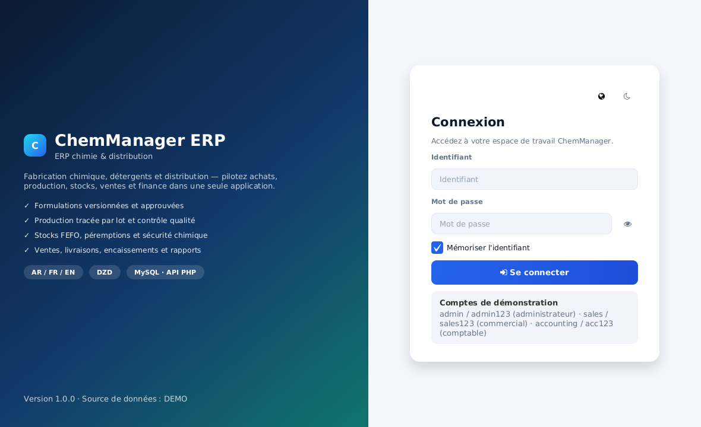
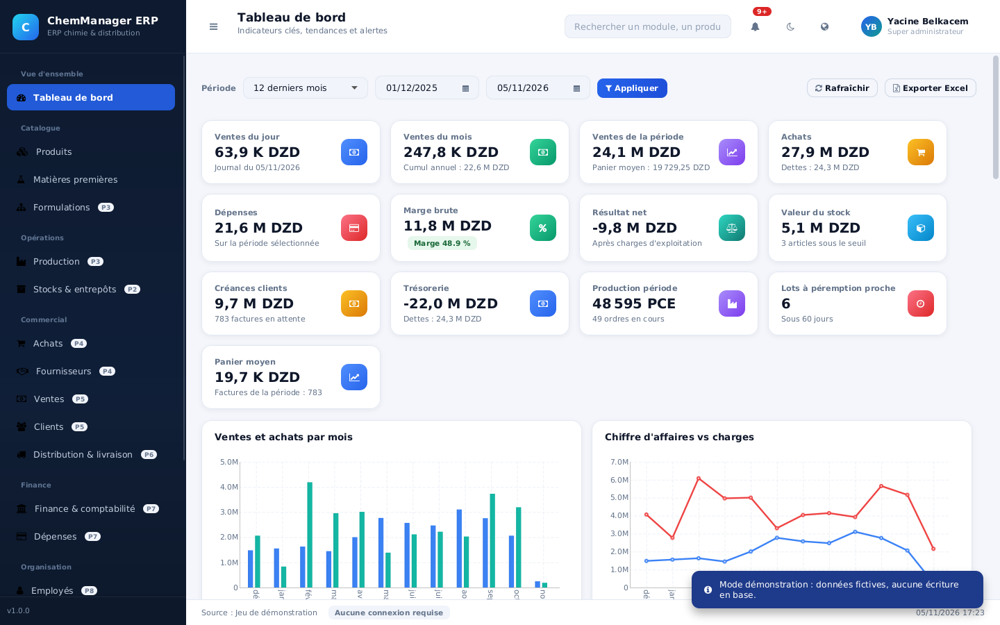
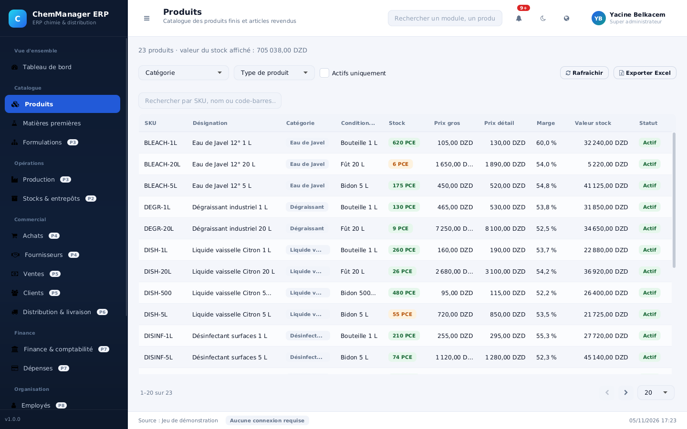
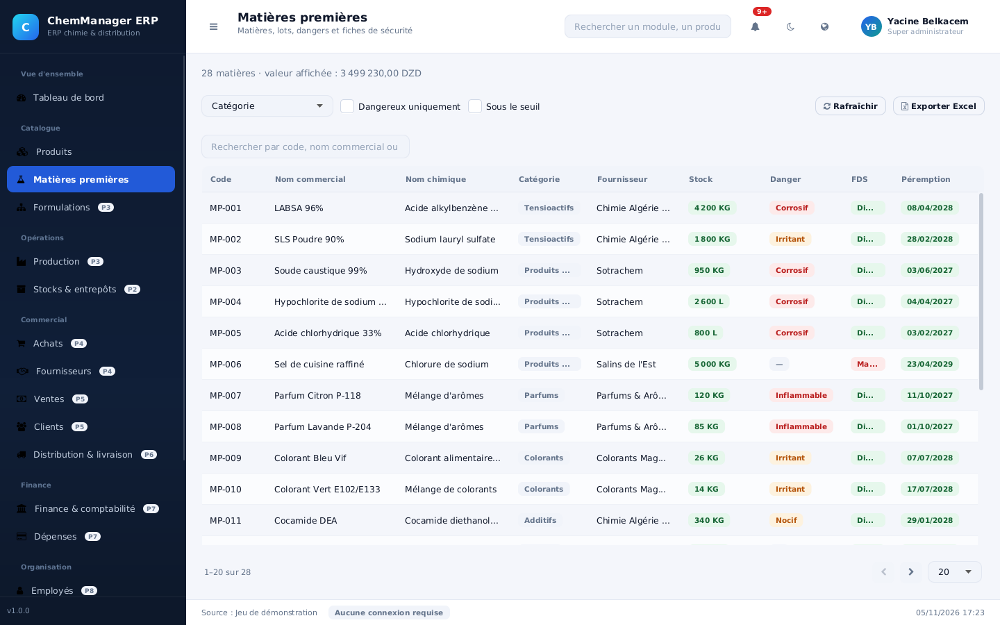
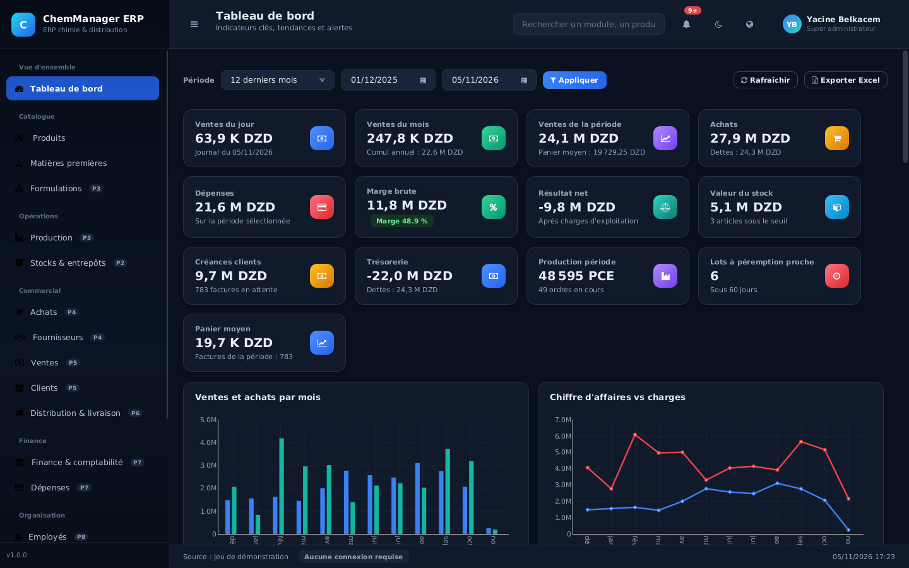
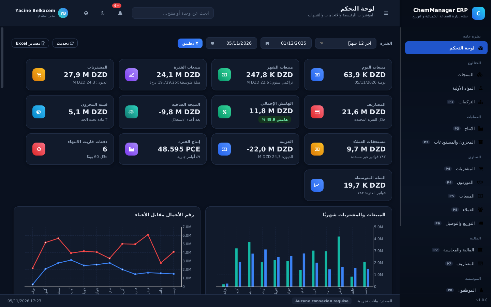

# ChemManager ERP

Desktop ERP for a chemical manufacturing, detergent and distribution company operating in
Algeria (currency **DZD**, tax rates configurable, documents in **Arabic / French / English**).

ChemManager covers the whole value chain of the business — raw materials and their safety
data, approved formulations, batch-controlled production, FEFO warehousing, purchasing,
sales, delivery, finance and reporting — on top of a JavaFX client and a plain-PHP REST API
backed by MySQL 8.

> **Delivery status**
>
> * **Phase 1 — complete:** project foundation, design system, documentation, login, application
>   shell (sidebar, header, notifications, themes, AR/FR/EN) and the executive dashboard with
>   data read from the service layer. Modules of later phases are visible in the navigation with
>   their phase badge; they open a "planned capabilities" screen, so no button is dead and no
>   screen is a mock-up — see [`docs/PHASE-1-REPORT.md`](docs/PHASE-1-REPORT.md).
> * **Phase 2 — complete:** MySQL 8 database (68 tables, camelCase without underscores, seeds) and
>   the framework-free PHP REST API (auth, RBAC, 46 endpoints) — both verified in CI against a real
>   MySQL 8, 25 unit + 113 end-to-end API tests — see
>   [`docs/PHASE-2-REPORT.md`](docs/PHASE-2-REPORT.md).
> * **Phase 3 — complete:** formulations — families, versions, bill of materials priced from the
>   current purchase prices, approval that locks the version, version comparison, on both halves.
>   The application never generates a formula — see
>   [`docs/PHASE-3-REPORT.md`](docs/PHASE-3-REPORT.md).
> * **Phase 4 — complete:** inventory, warehouses, FEFO allocation and purchasing — batch-level
>   stock summed from the batch rows, an append-only movement ledger, physical counts and transfers
>   that always name a reason, suppliers, purchase orders and atomic goods receptions. The schema
>   key of a batch now includes its warehouse, so one physical batch can be split between stores —
>   see [`docs/PHASE-4-REPORT.md`](docs/PHASE-4-REPORT.md).
> * **Design system — enforced:** every colour is a token declared by both themes and validated
>   against a 62-pair contrast contract, font sizes stay on a nine-step scale (nothing below
>   11 px), focus is always visible and Arabic switches its own typography. `tools/ui/checkDesign.py`
>   runs in CI and `DesignSystemTest` fails the build when a token, a ratio or this document drifts
>   — see [`docs/03-design-system.md`](docs/03-design-system.md).
> * **Phase 5 — complete:** production — manufacturing orders from an approved formulation version,
>   FEFO material reservation, consumption through the stock ledger, quality checks that decide what
>   may be sold, the real cost of the run with its variance, and batch genealogy down to the supplier
>   reception. A finished batch stays in quarantine until a `PASS` check releases it — see
>   [`docs/PHASE-5-REPORT.md`](docs/PHASE-5-REPORT.md).
> * **Phase 6 — complete:** customers and their credit guard, the commercial chain
>   quotation → order → delivery note → invoice → payment → credit note, the fleet and its daily
>   tours with proof of delivery, and the printable documents in FR/EN/AR. Stock leaves through the
>   exact batches a delivery note names, and an issued invoice is frozen — only a payment or a credit
>   note can move it — see [`docs/PHASE-6-REPORT.md`](docs/PHASE-6-REPORT.md).
> * **Phase 7 — complete:** the accounting calendar with its closing guard, the cash book fed by every
>   settlement, the expenses with their approval and payment, the staff file with attendance and leave,
>   the monthly payroll booked as an expense, and the three statements (margin by product, cash flow,
>   period result) — see [`docs/PHASE-7-REPORT.md`](docs/PHASE-7-REPORT.md).
> * **Phase 8 — complete:** the chemical register — safety data sheets with their three-year validity
>   window, handling instructions, GHS pictograms and the incident book with its
>   investigation-before-closure rule — and the report centre: eight reports (result, margin, cash
>   flow, sales, purchases, stock valuation, production, chemical safety) with an Excel export, on
>   top of the three statements of Phase 7 — see [`docs/PHASE-8-REPORT.md`](docs/PHASE-8-REPORT.md).
> * **Test harness:** 134 desktop tests — 39 of them driven by **TestFX** through the real user
>   interface (sign-in, password masking, shell, sidebar navigation, live Arabic mirroring,
>   inventory, purchasing, suppliers, production, customers, sales, distribution, finance, expenses,
>   employees, reports, safety, the report centre, focus ring, accessible names) — and 25 + 470 API
>   tests against a real MySQL 8. The rules the project is built under live in
>   [`docs/devRules.md`](docs/devRules.md) and in the Google Doc `devRules`.
> * **Phase 9 — next:** hardening — uploads for the sheet library, HSE reminders, broader coverage of
>   the earlier phases.

---

## 1. Technology

| Layer | Technology |
| --- | --- |
| Desktop client | Java 21, JavaFX 21.0.4 (FXML + CSS), Maven |
| Charts / tables | JavaFX built-in `LineChart`, `BarChart`, `PieChart`, virtualised `TableView` |
| Icons | FontAwesomeFX 9.1.2 |
| JSON / HTTP | Jackson 2.17 (`jackson-databind`, `jackson-datatype-jsr310`), `java.net.http.HttpClient` |
| Excel export | Apache POI 5.2.5 (`XSSFWorkbook`) |
| Persistence | MySQL 8 (InnoDB, `utf8mb4`) — accessed **only** through the PHP API |
| REST API | Pure PHP 8 (no framework, no Composer), PDO prepared statements |
| Security | Server-side RBAC, bcrypt (`password_hash`), bearer tokens, audit log |
| Tests | JUnit 5.10 (surefire) for logic, **TestFX 4.0.18** for the user interface (real clicks and typing, headless via Xvfb) |

The client never holds database credentials: it talks to the PHP API over HTTP. `data.mode`
selects the data source (`MOCK` demo dataset, `API` PHP backend, or `AUTO` = probe then
fall back), so the application is runnable without any infrastructure.

## 2. Build and run

Requirements: **JDK 21** and **Maven 3.9+**.

```bash
mvn clean verify          # compile + run the JUnit test suite
mvn javafx:run            # start the desktop application
mvn -DskipTests package   # build target/chemmanager-erp.jar
```

Running against the PHP API instead of the demo dataset:

```bash
java -Ddata.mode=API -Dapi.base.url=http://192.168.1.20/api -jar target/chemmanager-erp.jar
```

Every key of [`src/main/resources/app.properties`](src/main/resources/app.properties) can be
overridden by a system property (`-Ddata.mode=...`) or an environment variable
(`CHEMMANAGER_DATA_MODE`, `CHEMMANAGER_API_URL`); secrets never live in the repository.

### Demo accounts (offline `MOCK` mode)

| Username | Password | Role |
| --- | --- | --- |
| `admin` | `admin123` | Super administrator (all permissions) |
| `manager` | `manager123` | General manager |
| `production` | `prod123` | Production manager |
| `store` | `store123` | Warehouse manager |
| `sales` | `sales123` | Sales manager |
| `accounting` | `acc123` | Accountant |

Demo passwords are hashed with PBKDF2-HMAC-SHA256 at start-up; in API mode hashing is done by
PHP `password_hash()` (bcrypt) and the client never receives a hash.

## 3. Screenshots of the delivered build

| | |
| --- | --- |
|  |  |
| Login (light theme) | Dashboard — every KPI computed from transactions |
|  |  |
| Product catalogue with stock, prices and margins | Raw materials with hazard, SDS and expiry |
|  |  |
| Dark theme | Arabic, full RTL layout |

The images are produced by the headless boot test on every push, so they always show the current
build; the full set (users, settings, inventory, purchasing, production, English) is in
[`docs/screenshots/`](docs/screenshots).

## 4. What Phase 1 delivers

* **Login** — validated form, password reveal toggle, throttling after repeated failures,
  remembered username, error messages translated from the service layer, demo hint.
* **Shell** — collapsible grouped sidebar (8 sections, 18 modules), header with page title,
  global module search, notification popup with unread badge, theme switch, language switch
  (instant, no restart), user menu with profile details and sign-out confirmation, status bar
  with data source, connectivity state and clock.
* **Dashboard** — KPI cards (sales today / month / range, gross margin, net profit, inventory
  value, receivables, cash), sales-vs-purchases and revenue-vs-costs charts, production chart,
  revenue-by-category pie, best sellers, most profitable products, top customers, low stock
  and expiry alerts (FEFO), recent activity feed, date-range presets and an Excel export.
  **Every value is computed from stored records** by `MockDashboardService` in demo mode and by
  `DashboardRepository.php` (SQL aggregates over the real ledger) in API mode — nothing is
  hardcoded and nothing is stored twice.
* **Products** — searchable, filterable, paged product table with stock value, margins,
  product detail dialog and Excel export.
* **Raw materials** — batch/expiry/hazard columns, hazardous and low-stock filters, SDS
  availability, storage location, detail dialog, Excel export.
* **Users & permissions** — user table with roles, status, last sign-in and a role/permission
  matrix rendered from `DefaultRoles`, plus export.
* **Settings** — general preferences (theme, language, currency, VAT, invoice prefix),
  company identity used on documents, and the data-source panel that probes the API and
  switches between demo and API mode.
* **Bilingual / RTL** — complete AR (RTL), FR (LTR) and EN bundles (509 keys) kept in sync by
  a parity test; `NodeOrientation` flips the whole scene graph, not just the labels.
* **Light / dark themes** — CSS-variable style sheets applied at runtime.
* **Tests** — bundles parity, PBKDF2 hashing, the 12-role permission matrix, money rounding,
  date ranges, the dashboard aggregations (computed vs. recomputed from the dataset) and a
  headless boot test that opens every screen and captures the screenshots above.
* **Tooling** — `python3 tools/fxml_check.py` validates every FXML against its controller
  (ids, handlers, i18n keys, style classes) without a JVM.

Screens that belong to the phases still open (sales, customers, distribution, finance, expenses,
employees, reports, chemical safety) already have their route, permission and screen; each shows the
planned capabilities of the module plus the phase that delivers it. There are no disabled or decorative buttons: every control in
the interface performs the action it advertises.

## 5. Repository layout

```
pom.xml                              Maven build (Java 21 + JavaFX 21)
src/main/java/com/chemmanager/
  app/                               ChemManagerApp (composition root), AppContext
  config/                            AppConfig, ThemeManager, UserPreferences, Theme, DataMode
  localization/                      I18n (locale property, RTL flag, MessageFormat)
  security/                          Permission, Role, DefaultRoles, Session, PasswordHasher
  model/                             Product, RawMaterial, User, DateRange, Severity + analytics/
  dto/                               PagedResult, ProductQuery, MaterialQuery, API payloads
  validation/                        Validator / ValidationResult (i18n message keys)
  api/                               ApiClient, ApiEndpoints, ApiException, JsonMapper
  repository/                        MockDataStore (demo dataset) + settings repositories
  service/                           service interfaces, mock/ and api/ implementations
  component/                         KpiCard, Card, DataTable, ChartFactory, FormFields, …
  navigation/                        NavGroup, NavigationModule, NavigationManager
  controller/                        shell + auth + one package per module
  util/                              Formatters, Money, DateRanges, FxTasks, ExcelExporter, …
src/main/resources/
  fxml/                              20 FXML screens
  css/                               app.css, theme-light.css, theme-dark.css
  i18n/                              messages_fr/ar/en.properties (generated)
tools/i18n/                          translation sources + build.py + audit.py
tools/db/                            checkSchema.py (CI validator), generateErDoc.py
database/schema/                     8 DDL files, 68 tables (camelCase, no underscore)
database/seed/                       6 seeders: permissions, roles, reference data, admin, settings
backend/public/index.php             front controller of the PHP REST API
backend/src/                         Core (router, PDO, envelope), Security (auth, RBAC),
                                     Repositories (all SQL), Controllers, routes.php
backend/tests/                       unit (25) + integration (470) suites, run in CI on MySQL 8
docs/                                architecture, ER diagram, design system, roadmap, RBAC
.github/workflows/ci.yml             build + tests, publishes logs to the ci-reports branch
```

## 6. Documentation

| Document | Content |
| --- | --- |
| [`docs/01-architecture.md`](docs/01-architecture.md) | Layers, module map, request flow, Maven structure, configuration |
| [`docs/02-er-diagram.md`](docs/02-er-diagram.md) | Entity/relationship diagram and the full relational model |
| [`docs/03-design-system.md`](docs/03-design-system.md) | Colours, typography, spacing, components, RTL, theming |
| [`docs/DESIGN-REVISION.md`](docs/DESIGN-REVISION.md) | Why the styles changed before Phase 5: focus, contrast, tokens, type scale, Arabic |
| [`docs/04-roadmap.md`](docs/04-roadmap.md) | Eight delivery phases and their acceptance criteria |
| [`docs/05-security-rbac.md`](docs/05-security-rbac.md) | 12 roles × permissions matrix, auth flow, audit rules |
| [`docs/07-operations.md`](docs/07-operations.md) | Backups, restore drill, deployment, monitoring |
| [`docs/PHASE-1-REPORT.md`](docs/PHASE-1-REPORT.md) | Phase 1 delivery report: verification, deliverables, review checklist |
| [`docs/PHASE-2-REPORT.md`](docs/PHASE-2-REPORT.md) | Phase 2 report: 68-table database, seeds, PHP REST API, 113 end-to-end tests |
| [`docs/PHASE-8-REPORT.md`](docs/PHASE-8-REPORT.md) | Phase 8 report: the chemical register, its validity window, the incident book and the report centre, 134 desktop tests and 470 API checks |
| [`docs/PHASE-7-REPORT.md`](docs/PHASE-7-REPORT.md) | Phase 7 report: closed months, the cash book, expenses, payroll and the financial statements, 99 desktop tests and 439 API checks |
| [`docs/PHASE-6-REPORT.md`](docs/PHASE-6-REPORT.md) | Phase 6 report: credit guard, the sales chain, frozen invoices, tours and printable documents, 79 desktop tests and 347 API checks |
| [`docs/PHASE-5-REPORT.md`](docs/PHASE-5-REPORT.md) | Phase 5 report: production orders, quality release, batch genealogy, 71 desktop tests and 241 API checks |
| [`docs/PHASE-3-REPORT.md`](docs/PHASE-3-REPORT.md) | Phase 3 report: formulations, versioning, approval lock, comparison |
| [`docs/PHASE-4-REPORT.md`](docs/PHASE-4-REPORT.md) | Phase 4 report: batches, FEFO, ledger, purchasing and goods reception |
| [`docs/devRules.md`](docs/devRules.md) | The project's binding development rules, mirrored from the Google Doc `devRules` |
| [`database/README.md`](database/README.md) | Schema conventions, installation, least-privilege account, enforced rules |

## 7. Editing the translations

The `.properties` bundles are generated so that the three languages cannot drift apart:

```bash
python3 tools/i18n/build.py    # validates parity, rewrites messages_{fr,ar,en}.properties
python3 tools/i18n/audit.py    # checks that every key used in Java/FXML exists
```

`src/main/resources/i18n/messages_fr.properties` is the reference bundle: a key added there
must be translated in `tools/i18n/ar.py` and `tools/i18n/en.py`, otherwise the build step and
`BundleParityTest` fail.

## 8. Continuous integration

`.github/workflows/ci.yml` runs two jobs on every push:

1. **database + client** — validates the schema (identifiers, foreign keys, seed consistency,
   generated ER document) and the design system (tokens, contrast, type scale, document drift),
   then compiles the JavaFX client under Xvfb and runs its unit and TestFX user-interface tests;
2. **API** — starts a **MySQL 8 service container**, executes `database/schema/*.sql` and
   `database/seed/*.sql` for real, lints every PHP file, then runs the 25 unit tests and the
   241 end-to-end HTTP tests against the running API.

The
full Maven log, the surefire reports and a glyph inventory are published to the `ci-reports`
branch so a build failure can be diagnosed without downloading artefacts.
