# ChemManager ERP — Entity / Relationship Model

The relational model below is the target schema for MySQL 8 (`InnoDB`, `utf8mb4_unicode_ci`).
Phase 1 documents it and the demo dataset (`MockDataStore`) is shaped to match it one-to-one,
so the SQL implementation in Phase 2 is a mechanical translation of these tables.

Conventions used by every table:

* surrogate `BIGINT UNSIGNED AUTO_INCREMENT` primary keys, business codes additionally unique;
* `created_at`, `updated_at` (`DATETIME`), `created_by`, `updated_by` (`users.id`);
* soft delete through `deleted_at DATETIME NULL` and/or `is_active TINYINT(1)` — financial and
  stock history is **never** physically deleted;
* money `DECIMAL(15,2)`, quantities `DECIMAL(15,3)`, VAT and rates `DECIMAL(5,2)`;
* currency stored per document (`currency CHAR(3)` default `DZD`) so historical documents keep
  the rate they were issued with;
* every status column is an `ENUM` mirrored by a Java/PHP constant list.

## 1. Overview diagram

```mermaid
erDiagram
    USERS ||--o{ USER_ROLES : has
    ROLES ||--o{ USER_ROLES : granted
    ROLES ||--o{ ROLE_PERMISSIONS : contains
    PERMISSIONS ||--o{ ROLE_PERMISSIONS : in
    USERS ||--o{ AUDIT_LOGS : writes
    USERS ||--o{ NOTIFICATIONS : receives

    PRODUCT_CATEGORIES ||--o{ PRODUCTS : classifies
    PRODUCTS ||--o{ PRODUCT_BATCHES : "produced in"
    RAW_MATERIAL_CATEGORIES ||--o{ RAW_MATERIALS : classifies
    SUPPLIERS ||--o{ RAW_MATERIALS : supplies
    RAW_MATERIALS ||--o{ MATERIAL_BATCHES : "held as"
    SUPPLIERS ||--o{ MATERIAL_BATCHES : "delivered"

    FORMULATIONS ||--o{ FORMULATION_VERSIONS : versions
    FORMULATION_VERSIONS ||--o{ FORMULATION_ITEMS : "composed of"
    RAW_MATERIALS ||--o{ FORMULATION_ITEMS : used_in
    FORMULATIONS ||--o{ PRODUCTS : "produces"

    PRODUCTION_ORDERS ||--o{ PRODUCTION_MATERIALS : consumes
    PRODUCTION_ORDERS ||--o{ PRODUCTION_OUTPUTS : yields
    MATERIAL_BATCHES ||--o{ PRODUCTION_MATERIALS : "issued from"
    PRODUCTION_ORDERS ||--o{ QUALITY_CHECKS : checked_by

    WAREHOUSES ||--o{ STOCK_MOVEMENTS : records
    PRODUCT_BATCHES ||--o{ STOCK_MOVEMENTS : moves
    MATERIAL_BATCHES ||--o{ STOCK_MOVEMENTS : moves

    SUPPLIERS ||--o{ PURCHASE_ORDERS : receives
    PURCHASE_ORDERS ||--o{ PURCHASE_ORDER_ITEMS : contains
    PURCHASE_ORDERS ||--o{ GOODS_RECEIPTS : delivered_by
    GOODS_RECEIPTS ||--o{ GOODS_RECEIPT_ITEMS : contains
    SUPPLIERS ||--o{ SUPPLIER_INVOICES : bills
    SUPPLIER_INVOICES ||--o{ SUPPLIER_PAYMENTS : settled_by

    CUSTOMERS ||--o{ SALES_ORDERS : places
    SALES_ORDERS ||--o{ SALES_ORDER_ITEMS : contains
    SALES_ORDERS ||--o{ DELIVERY_NOTES : shipped_by
    DELIVERY_NOTES ||--o{ DELIVERY_ITEMS : contains
    SALES_ORDERS ||--o{ INVOICES : billed_as
    INVOICES ||--o{ INVOICE_ITEMS : contains
    INVOICES ||--o{ PAYMENTS : settled_by
    CUSTOMERS ||--o{ PAYMENTS : pays

    VEHICLES ||--o{ DELIVERY_ROUTES : used_for
    EMPLOYEES ||--o{ DELIVERY_ROUTES : drives
    DELIVERY_ROUTES ||--o{ DELIVERY_NOTES : carries

    EXPENSE_CATEGORIES ||--o{ EXPENSES : classifies
    EMPLOYEES ||--o{ SALARY_PAYMENTS : receives
    EXPENSES ||--o{ SALARY_PAYMENTS : "paid via"
    CASH_ACCOUNTS ||--o{ PAYMENTS : receives
    CASH_ACCOUNTS ||--o{ EXPENSES : pays

    RAW_MATERIALS ||--o| SAFETY_DATA_SHEETS : documented_by
    SAFETY_DATA_SHEETS ||--o{ SAFETY_PICTOGRAMS : displays
    SAFETY_INCIDENTS }o--|| RAW_MATERIALS : involves
    COMPANIES ||--o{ COMPANIES : "settings"
```

## 2. Tables

### 2.1 Organisation and access control

| Table | Key columns | Notes |
| --- | --- | --- |
| `companies` | `id`, `name`, `legal_name`, `activity`, `address`, `city`, `wilaya`, `postal_code`, `phone`, `email`, `website`, `tax_id`, `rc`, `nif`, `ai`, `currency`, `vat_rate`, `invoice_prefix`, `logo_path` | single row (id = 1) printed on every document |
| `users` | `id`, `username` (u), `password_hash`, `full_name`, `email`, `phone`, `job_title`, `department_id`, `is_active`, `last_login_at`, `failed_attempts`, `locked_until` | bcrypt hash produced server-side |
| `roles` | `id`, `code` (u), `name_fr/ar/en`, `description_fr/ar/en`, `is_system` | 12 seeded roles |
| `permissions` | `id`, `code` (u), `module`, `label_fr/ar/en` | 44 codes, mirror of `Permission` |
| `role_permissions` | `role_id`, `permission_id` | PK (role_id, permission_id) |
| `user_roles` | `user_id`, `role_id` | a user may hold several roles; effective rights = union |
| `audit_logs` | `id`, `user_id`, `action`, `module`, `entity`, `entity_id`, `reference`, `severity`, `ip_address`, `payload JSON`, `occurred_at` | append-only; no UPDATE/DELETE grant |
| `notifications` | `id`, `user_id`, `title_key`, `message`, `severity`, `link_module`, `link_id`, `is_read`, `created_at` | badge + popup in the header |

### 2.2 Catalogue

| Table | Key columns | Notes |
| --- | --- | --- |
| `product_categories` | `id`, `code` (u), `name_fr/ar/en`, `sort_order` | dishwashing, floor cleaner, bleach, … |
| `products` | `id`, `sku` (u), `barcode`, `name_fr`, `name_ar`, `description`, `category_id`, `type ENUM(MANUFACTURED,TRADED,RAW_MATERIAL,PACKAGING)`, `unit`, `packaging`, `packaging_capacity`, `units_per_carton`, `min_stock`, `max_stock`, `purchase_cost`, `production_cost`, `wholesale_price`, `retail_price`, `special_price`, `vat_rate`, `image_path`, `is_active` | formula variants share a `formulation_id` |
| `raw_material_categories` | `id`, `code` (u), `name_fr/ar/en` | chemical, surfactant, fragrance, colourant, additive, solvent, packaging |
| `raw_materials` | `id`, `code` (u), `commercial_name`, `chemical_name`, `category_id`, `supplier_id`, `purchase_unit`, `storage_unit`, `conversion_factor`, `purchase_price`, `min_stock`, `storage_location`, `hazard_class`, `hazard_pictograms` (`GHS02,GHS05`), `storage_conditions`, `sds_available`, `sds_file`, `is_active` | no stock column: quantities come from `material_batches` |
| `suppliers` | `id`, `code` (u), `name`, `contact_name`, `phone`, `email`, `address`, `wilaya`, `payment_terms`, `balance`, `is_active` | balance maintained by payments/invoices |
| `customers` | `id`, `code` (u), `name`, `type ENUM(INDIVIDUAL,COMPANY)`, `phone`, `email`, `address`, `wilaya`, `credit_limit`, `balance`, `price_segment`, `is_active` | credit limit enforced on orders |

### 2.3 Formulation and production

| Table | Key columns | Notes |
| --- | --- | --- |
| `formulations` | `id`, `code` (u), `name_fr`, `name_ar`, `product_id`, `current_version_id`, `status ENUM(DRAFT,PENDING,APPROVED,ARCHIVED)`, `approved_by`, `approved_at` | never generated by the software |
| `formulation_versions` | `id`, `formulation_id`, `version`, `instructions TEXT`, `expected_yield`, `yield_unit`, `is_locked`, `created_by`, `approved_by`, `approved_at` | immutable once approved |
| `formulation_items` | `id`, `version_id`, `raw_material_id`, `quantity`, `unit`, `percentage`, `phase`, `tolerance_pct`, `sort_order` | bill of materials of one version |
| `production_orders` | `id`, `order_number` (u), `formulation_version_id`, `product_id`, `planned_qty`, `actual_qty`, `waste_qty`, `warehouse_id`, `status ENUM(DRAFT,WAITING_MATERIALS,APPROVED,IN_PROGRESS,QUALITY_CONTROL,COMPLETED,REJECTED,CANCELLED)`, `planned_date`, `started_at`, `completed_at`, `material_cost`, `packaging_cost`, `other_cost`, `operator_id` | `actual_qty` booked only after QC release |
| `production_materials` | `id`, `order_id`, `material_batch_id`, `planned_qty`, `consumed_qty`, `unit` | batch traceability link |
| `production_outputs` | `id`, `order_id`, `product_batch_id`, `quantity`, `unit` | finished goods created by the order |
| `quality_checks` | `id`, `order_id`, `check_type`, `parameters JSON`, `result ENUM(PASS,FAIL,PENDING)`, `checked_by`, `checked_at`, `remarks` | a batch cannot be released before PASS |

### 2.4 Warehousing

| Table | Key columns | Notes |
| --- | --- | --- |
| `warehouses` | `id`, `code` (u), `name`, `address`, `is_active` | raw material store, finished goods store, quarantine |
| `material_batches` | `id`, `material_id`, `batch_number`, `supplier_id`, `quantity`, `unit`, `production_date`, `expiry_date`, `warehouse_id`, `quality_status ENUM(QUARANTINE,RELEASED,REJECTED)`, `purchase_price` | FEFO orders by `expiry_date` |
| `product_batches` | `id`, `product_id`, `batch_number`, `quantity`, `unit`, `production_date`, `expiry_date`, `warehouse_id`, `production_order_id`, `quality_status`, `unit_cost` | `production_order_id` gives full traceability |
| `stock_movements` | `id`, `movement_number` (u), `movement_type ENUM(IN,OUT,TRANSFER,ADJUSTMENT,RETURN,PRODUCTION_IN,PRODUCTION_OUT,WASTE)`, `warehouse_id`, `target_warehouse_id`, `material_batch_id`, `product_batch_id`, `quantity`, `unit_cost`, `reference_type`, `reference_id`, `reason`, `user_id`, `occurred_at` | append-only ledger; balances are views |
| `stock_counts` / `stock_count_items` | `id`, `count_number`, `warehouse_id`, `status`, `counted_at` / `batch refs`, `system_qty`, `counted_qty`, `difference` | adjustments create movements, never edit history |

### 2.5 Purchasing

| Table | Key columns |
| --- | --- |
| `purchase_requests` / `purchase_request_items` | `request_number`, `requested_by`, `status`, `needed_by` / `material_id`, `quantity`, `unit` |
| `purchase_orders` | `order_number`, `supplier_id`, `status(DRAFT,SENT,PARTIAL,RECEIVED,CANCELLED)`, `order_date`, `expected_date`, `amount_ht`, `vat_amount`, `total_ttc`, `currency` |
| `purchase_order_items` | `order_id`, `material_id`, `quantity`, `unit_price`, `vat_rate`, `received_qty` |
| `goods_receipts` / `goods_receipt_items` | `receipt_number`, `purchase_order_id`, `received_at`, `warehouse_id`, `user_id` / `material_id`, `quantity`, `unit_price`, `batch_number`, `expiry_date` → creates `material_batches` + `stock_movements` |
| `supplier_invoices` | `invoice_number`, `supplier_id`, `purchase_order_id`, `invoice_date`, `due_date`, `amount_ht`, `vat_amount`, `total_ttc`, `paid_amount`, `status` |
| `supplier_payments` | `payment_number`, `supplier_invoice_id`, `amount`, `paid_at`, `method`, `cash_account_id`, `user_id` |

### 2.6 Sales and distribution

| Table | Key columns |
| --- | --- |
| `quotations` / `quotation_items` | `quote_number`, `customer_id`, `valid_until`, `status(DRAFT,SENT,ACCEPTED,EXPIRED,REJECTED)`, totals / `product_id`, `quantity`, `unit_price`, `discount_pct`, `vat_rate` |
| `sales_orders` | `order_number`, `customer_id`, `quotation_id`, `status(DRAFT,CONFIRMED,RESERVED,PARTIAL,INVOICED,CANCELLED)`, `order_date`, `delivery_date`, `amount_ht`, `vat_amount`, `total_ttc`, `representative_id` |
| `sales_order_items` | `order_id`, `product_id`, `quantity`, `unit_price`, `discount_pct`, `vat_rate`, `delivered_qty`, `invoiced_qty` |
| `delivery_notes` / `delivery_items` | `note_number`, `sales_order_id`, `customer_id`, `route_id`, `status(PREPARED,LOADED,IN_TRANSIT,DELIVERED,RETURNED)`, `delivered_at`, `signed_by`, `signature_path` / `product_batch_id` (FEFO pick), `quantity` |
| `invoices` | `invoice_number`, `customer_id`, `sales_order_id`, `invoice_date`, `due_date`, `amount_ht`, `vat_amount`, `total_ttc`, `paid_amount`, `status(DRAFT,ISSUED,PARTIAL,PAID,CANCELLED)`, `currency`, `finalized_at` | immutable once `ISSUED` |
| `invoice_items` | `invoice_id`, `product_id`, `product_batch_id`, `quantity`, `unit_price`, `discount_pct`, `vat_rate`, `line_total` |
| `credit_notes` / `credit_note_items` | `credit_number`, `invoice_id`, `reason`, `amount`, `status` |
| `payments` | `payment_number`, `customer_id`, `invoice_id`, `amount`, `paid_at`, `method(CASH,CHEQUE,TRANSFER,CARD,CREDIT)`, `cash_account_id`, `reference`, `user_id` |
| `vehicles` | `id`, `plate` (u), `model`, `capacity_kg`, `driver_id`, `is_active` |
| `delivery_routes` | `id`, `route_number`, `route_date`, `vehicle_id`, `driver_id`, `representative_id`, `wilaya_zone`, `status`, `fuel_cost` |
| `route_stops` | `route_id`, `delivery_note_id`, `sequence`, `arrived_at`, `status` |

### 2.7 Finance and expenses

| Table | Key columns |
| --- | --- |
| `cash_accounts` | `id`, `code`, `name`, `type(CASH,BANK)`, `bank_name`, `rib`, `opening_balance`, `currency`, `is_active` |
| `cash_transactions` | `id`, `cash_account_id`, `direction(IN,OUT)`, `amount`, `source_type`, `source_id`, `occurred_at`, `description` | mirrors payments/expenses for the cash book |
| `expense_categories` | `id`, `code` (u), `name_fr/ar/en`, `is_salary`, `is_vehicle` |
| `expenses` | `id`, `expense_number`, `category_id`, `label`, `amount`, `vat_amount`, `expense_date`, `payment_method`, `cash_account_id`, `supplier_id`, `vehicle_id`, `attachment_path`, `status(DRAFT,APPROVED,PAID)`, `user_id` |
| `accounting_periods` | `id`, `code`, `start_date`, `end_date`, `status(OPEN,CLOSED)`, `closed_by`, `closed_at` | posting into a closed period is refused |

### 2.8 Employees and payroll

| Table | Key columns |
| --- | --- |
| `departments` | `id`, `code`, `name_fr/ar/en`, `manager_id` |
| `employees` | `id`, `employee_number` (u), `first_name`, `last_name`, `department_id`, `position`, `phone`, `email`, `hire_date`, `contract_type`, `base_salary`, `user_id`, `is_active` |
| `attendance` | `id`, `employee_id`, `work_date`, `check_in`, `check_out`, `status(PRESENT,ABSENT,LEAVE,SICK,HOLIDAY,SITE)` |
| `leave_requests` | `id`, `employee_id`, `leave_type`, `start_date`, `end_date`, `status`, `approved_by` |
| `salary_payments` | `id`, `employee_id`, `period` (`YYYY-MM`), `base_amount`, `bonus`, `deductions`, `advance`, `net_amount`, `paid_at`, `expense_id` |

### 2.9 Chemical safety

| Table | Key columns |
| --- | --- |
| `safety_data_sheets` | `id`, `raw_material_id`, `document_type(SDS,TECHNICAL,DISPOSAL)`, `file_path`, `issue_date`, `revision`, `source`, `is_current` |
| `safety_pictograms` | `id`, `code` (`GHS02`), `name_fr/ar/en`, `image_path`, `description` |
| `material_pictograms` | `material_id`, `pictogram_id` |
| `safety_instructions` | `id`, `material_id`, `ppe`, `storage`, `handling`, `first_aid`, `fire_measures`, `spillage` |
| `safety_incidents` | `id`, `incident_number`, `material_id`, `incident_date`, `type(SPILL,EXPOSURE,FIRE,DAMAGE)`, `severity`, `description`, `actions_taken`, `reported_by`, `status` |

### 2.10 System

| Table | Key columns |
| --- | --- |
| `settings` | `id`, `key` (u), `value`, `group`, `updated_by`, `updated_at` | currency, VAT, prefixes, backup schedule |
| `backups` | `id`, `file_name`, `size_bytes`, `status(SUCCESS,FAILED)`, `started_at`, `finished_at`, `message` |
| `api_tokens` | `id`, `user_id`, `token_hash`, `issued_at`, `expires_at`, `revoked_at`, `ip_address` | hashed bearer tokens |

## 3. Relationship rules

1. **Inventory is batch based.** Stock is never stored on `products`/`raw_materials`; it is the
   sum of the batch rows, and every change goes through `stock_movements`. Negative stock is
   rejected by a trigger unless the acting user holds `INVENTORY_ADJUST` *and* the setting
   `allow_negative_stock` is enabled by an administrator.
2. **FEFO.** Any outward allocation sorts batches by `expiry_date ASC, production_date ASC`;
   quarantined or rejected batches (`quality_status <> 'RELEASED'`) are excluded.
3. **Formulation immutability.** `formulation_versions.is_locked` is set when the version is
   approved; the API refuses any update of a locked version, and a change requires a new
   version row.
4. **Invoice immutability.** `invoices.finalized_at` is set on issue; an issued invoice can
   only be corrected by a `credit_notes` row.
5. **Traceability.** `invoices → invoice_items → product_batches → production_orders →
   production_materials → material_batches → goods_receipts → suppliers` allows a complete
   forward/backward recall query from a single batch number.
6. **Audit.** Every insert/update on a business table writes an `audit_logs` row inside the
   same transaction; the API user has no `DELETE` grant on audit, stock and financial tables.
7. **Soft delete.** `deleted_at IS NULL` filters are part of every repository query; reporting
   views include deleted rows only with the `include_deleted` flag reserved to super admins.
