# ChemManager ERP — Entity / Relationship Model

The relational model is implemented in `database/schema/` (MySQL 8, `InnoDB`, `utf8mb4_unicode_ci`).
**This document is generated from those files** (`python3 tools/db/generateErDoc.py`), so every table
and column below exists in the DDL.

## Conventions

| Rule | Detail |
| --- | --- |
| Names | **lowerCamelCase, no underscore** — tables, columns, indexes, constraints, triggers and views |
| Primary keys | `id BIGINT UNSIGNED AUTO_INCREMENT`; business codes also unique |
| Foreign keys | `<entity>Id` (`customerId`, `productBatchId`) |
| Audit | `createdAt`, `updatedAt` (`DATETIME`), `createdBy`, `updatedBy` (`users.id`) |
| Soft delete | `deletedAt DATETIME NULL` and/or `isActive TINYINT(1)` — documents and stock history are never deleted |
| Numbers | money `DECIMAL(15,2)`, quantities `DECIMAL(15,3)`, rates `DECIMAL(7,4)`, currency `CHAR(3)` default `DZD` |
| Status | `ENUM` mirrored by a Java/PHP constant list |
| Indexes | `idx<Table><Purpose>`, unique `uq<Table><Purpose>`, `fk<Table><Target>`, `ck<Table><Rule>` |
| Views | `vw<Name>` |

## 1. Overview diagram

```mermaid
erDiagram
    USERS ||--o{ USERROLES : has
    ROLES ||--o{ USERROLES : granted
    ROLES ||--o{ ROLEPERMISSIONS : contains
    PERMISSIONS ||--o{ ROLEPERMISSIONS : in
    USERS ||--o{ APITOKENS : owns
    USERS ||--o{ AUDITLOGS : writes
    USERS ||--o{ NOTIFICATIONS : receives
    DEPARTMENTS ||--o{ EMPLOYEES : employs

    PRODUCTCATEGORIES ||--o{ PRODUCTS : classifies
    RAWMATERIALCATEGORIES ||--o{ RAWMATERIALS : classifies
    SUPPLIERS ||--o{ RAWMATERIALS : supplies
    SUPPLIERS ||--o{ MATERIALBATCHES : delivers
    PRODUCTS ||--o{ PRODUCTBATCHES : "produced as"
    RAWMATERIALS ||--o{ MATERIALBATCHES : "held as"
    WAREHOUSES ||--o{ MATERIALBATCHES : stores
    WAREHOUSES ||--o{ PRODUCTBATCHES : stores
    MATERIALBATCHES ||--o{ STOCKMOVEMENTS : moves
    PRODUCTBATCHES ||--o{ STOCKMOVEMENTS : moves

    FORMULATIONS ||--o{ FORMULATIONVERSIONS : versions
    FORMULATIONVERSIONS ||--o{ FORMULATIONITEMS : "composed of"
    RAWMATERIALS ||--o{ FORMULATIONITEMS : "used in"
    PRODUCTS ||--o{ FORMULATIONS : "manufactured by"
    PRODUCTIONORDERS ||--o{ PRODUCTIONMATERIALS : consumes
    PRODUCTIONORDERS ||--o{ PRODUCTIONOUTPUTS : yields
    PRODUCTIONORDERS ||--o{ QUALITYCHECKS : "checked by"
    PRODUCTIONORDERS ||--o{ PRODUCTBATCHES : produces

    PURCHASEORDERS ||--o{ PURCHASEORDERITEMS : contains
    PURCHASEORDERS ||--o{ GOODSRECEIPTS : received
    GOODSRECEIPTS ||--o{ GOODSRECEIPTITEMS : contains
    SALESORDERS ||--o{ SALESORDERITEMS : contains
    SALESORDERS ||--o{ DELIVERYNOTES : shipped
    DELIVERYNOTES ||--o{ DELIVERYITEMS : contains
    SALESORDERS ||--o{ INVOICES : billed
    INVOICES ||--o{ INVOICEITEMS : contains
    INVOICES ||--o{ CREDITNOTES : corrected
    CUSTOMERS ||--o{ SALESORDERS : places
    CUSTOMERS ||--o{ INVOICES : owes
    CUSTOMERS ||--o{ PAYMENTS : pays
    DELIVERYROUTES ||--o{ ROUTESTOPS : orders
    VEHICLES ||--o{ DELIVERYROUTES : serves

    CASHACCOUNTS ||--o{ CASHTRANSACTIONS : books
    CASHACCOUNTS ||--o{ PAYMENTS : receives
    CASHACCOUNTS ||--o{ SUPPLIERPAYMENTS : pays
    EXPENSECATEGORIES ||--o{ EXPENSES : classifies
    EMPLOYEES ||--o{ SALARYPAYMENTS : earns
    EMPLOYEES ||--o{ ATTENDANCE : checks
    ACCOUNTINGPERIODS ||--o{ CASHTRANSACTIONS : groups

    RAWMATERIALS ||--o| SAFETYINSTRUCTIONS : documented
    RAWMATERIALS ||--o{ SAFETYDATASHEETS : "has SDS"
    RAWMATERIALS ||--o{ MATERIALPICTOGRAMS : labelled
    SAFETYPICTOGRAMS ||--o{ MATERIALPICTOGRAMS : labels
```

## 2. Modules and tables

| # | File | Module | Tables |
| --- | --- | --- | --- |
| 1 | `01_core.sql` | Core - company, people, security | 10 |
| 2 | `02_organisation.sql` | Organisation - treasury and staff | 2 |
| 3 | `03_catalogue.sql` | Catalogue - products, materials, stock | 12 |
| 4 | `04_production.sql` | Production - formulas, orders, quality | 7 |
| 5 | `05_commerce.sql` | Commerce - purchasing, sales, distribution | 22 |
| 6 | `06_finance.sql` | Finance - cash, expenses, payroll | 7 |
| 7 | `07_safety.sql` | Chemical safety | 5 |
| 8 | `08_system.sql` | System - settings, numbering, views | 3 |

**68 tables** in total.

### 01_core.sql — Core - company, people, security

#### `companies`
*Company identity printed on documents*

- `id` `BIGINT UNSIGNED` **PK**, `name` `VARCHAR(150)`, `legalName` `VARCHAR(180)`, `activity` `VARCHAR(180)`, `address` `VARCHAR(255)`, `city` `VARCHAR(80)`, `wilaya` `VARCHAR(80)`, `postalCode` `VARCHAR(12)`, `country` `VARCHAR(80)`, `phone` `VARCHAR(40)`, `phoneSecond` `VARCHAR(40)` NULL, `email` `VARCHAR(120)`, `website` `VARCHAR(120)` NULL, `taxId` `VARCHAR(40)`, `tradeRegister` `VARCHAR(40)`, `nif` `VARCHAR(40)`, `taxArticle` `VARCHAR(40)`, `logoPath` `VARCHAR(255)` NULL, `currency` `CHAR(3)`, `vatRate` `DECIMAL(7,4)`, `invoicePrefix` `VARCHAR(10)`, `quotationPrefix` `VARCHAR(10)`, `deliveryPrefix` `VARCHAR(10)`, `fiscalYearStart` `TINYINT UNSIGNED`, `createdAt` `DATETIME`, `updatedAt` `DATETIME`, `updatedBy` `BIGINT UNSIGNED` NULL

#### `departments`
*Production, warehouse, sales, finance, quality...*

- `id` `BIGINT UNSIGNED` **PK**, `code` `VARCHAR(20)`, `nameFr` `VARCHAR(80)`, `nameAr` `VARCHAR(80)`, `nameEn` `VARCHAR(80)` NULL, `managerId` `BIGINT UNSIGNED` NULL, `isActive` `TINYINT(1)`, `createdAt` `DATETIME`, `updatedAt` `DATETIME`, `deletedAt` `DATETIME` NULL
- Keys: `uqDepartmentsCode`, `idxDepartmentsManager`

#### `users`
*Application accounts - passwords are bcrypt hashes produced by the API*

- `id` `BIGINT UNSIGNED` **PK**, `username` `VARCHAR(40)`, `passwordHash` `VARCHAR(255)`, `fullName` `VARCHAR(120)`, `email` `VARCHAR(120)`, `phone` `VARCHAR(40)`, `jobTitle` `VARCHAR(80)`, `departmentId` `BIGINT UNSIGNED` NULL, `isActive` `TINYINT(1)`, `lastLoginAt` `DATETIME` NULL, `lastLoginIp` `VARCHAR(45)` NULL, `failedAttempts` `SMALLINT UNSIGNED`, `lockedUntil` `DATETIME` NULL, `passwordChangedAt` `DATETIME` NULL, `mustChangePassword` `TINYINT(1)`, `createdAt` `DATETIME`, `updatedAt` `DATETIME`, `createdBy` `BIGINT UNSIGNED` NULL, `updatedBy` `BIGINT UNSIGNED` NULL, `deletedAt` `DATETIME` NULL
- Keys: `uqUsersUsername`, `uqUsersEmail`, `idxUsersDepartment`, `idxUsersActive`
- References: `departmentId` → `departments.id`

#### `permissions`
*44 atomic permissions - mirror of com.chemmanager.security.Permission*

- `id` `BIGINT UNSIGNED` **PK**, `code` `VARCHAR(40)`, `module` `VARCHAR(40)`, `labelFr` `VARCHAR(80)`, `labelAr` `VARCHAR(80)`, `labelEn` `VARCHAR(80)` NULL, `sortOrder` `SMALLINT UNSIGNED`
- Keys: `uqPermissionsCode`, `idxPermissionsModule`

#### `roles`
*The 12 seeded roles; system roles cannot be deleted*

- `id` `BIGINT UNSIGNED` **PK**, `code` `VARCHAR(40)`, `nameFr` `VARCHAR(80)`, `nameAr` `VARCHAR(80)`, `nameEn` `VARCHAR(80)` NULL, `descriptionFr` `VARCHAR(180)`, `descriptionAr` `VARCHAR(180)`, `descriptionEn` `VARCHAR(180)` NULL, `isSystem` `TINYINT(1)`, `createdAt` `DATETIME`, `updatedAt` `DATETIME`, `deletedAt` `DATETIME` NULL
- Keys: `uqRolesCode`

#### `rolePermissions`
*Role to permission matrix enforced by the API*

- `roleId` `BIGINT UNSIGNED`, `permissionId` `BIGINT UNSIGNED`, `grantedAt` `DATETIME`, `grantedBy` `BIGINT UNSIGNED` NULL
- Keys: `idxRolePermissionsPermission`
- References: `roleId` → `roles.id`, `permissionId` → `permissions.id`

#### `userRoles`
*Effective rights of a user = union of its roles*

- `userId` `BIGINT UNSIGNED`, `roleId` `BIGINT UNSIGNED`, `grantedAt` `DATETIME`, `grantedBy` `BIGINT UNSIGNED` NULL
- Keys: `idxUserRolesRole`
- References: `userId` → `users.id`, `roleId` → `roles.id`

#### `apiTokens`
*Bearer tokens - expired rows are purged weekly*

- `id` `BIGINT UNSIGNED` **PK**, `userId` `BIGINT UNSIGNED`, `tokenHash` `CHAR(64)`, `issuedAt` `DATETIME`, `expiresAt` `DATETIME`, `revokedAt` `DATETIME` NULL, `ipAddress` `VARCHAR(45)` NULL, `userAgent` `VARCHAR(255)` NULL
- Keys: `uqApiTokensHash`, `idxApiTokensUser`, `idxApiTokensExpiry`
- References: `userId` → `users.id`

#### `auditLogs`
*Append-only trail - the API account has no UPDATE or DELETE grant*

- `id` `BIGINT UNSIGNED` **PK**, `userId` `BIGINT UNSIGNED` NULL, `username` `VARCHAR(40)`, `action` `VARCHAR(40)`, `module` `VARCHAR(40)`, `entity` `VARCHAR(60)`, `entityId` `BIGINT UNSIGNED` NULL, `reference` `VARCHAR(60)`, `severity` `ENUM('INFO','WARNING','CRITICAL')`, `ipAddress` `VARCHAR(45)` NULL, `payload` `JSON` NULL, `occurredAt` `DATETIME`
- Keys: `idxAuditLogsOccurred`, `idxAuditLogsUser`, `idxAuditLogsEntity`, `idxAuditLogsModule`
- References: `userId` → `users.id`

#### `notifications`
*Badge and popup of the application header*

- `id` `BIGINT UNSIGNED` **PK**, `userId` `BIGINT UNSIGNED` NULL, `titleKey` `VARCHAR(80)`, `message` `VARCHAR(255)`, `severity` `ENUM('INFO','WARNING','CRITICAL')`, `linkModule` `VARCHAR(40)` NULL, `linkId` `BIGINT UNSIGNED` NULL, `isRead` `TINYINT(1)`, `readAt` `DATETIME` NULL, `createdAt` `DATETIME`
- Keys: `idxNotificationsUser`
- References: `userId` → `users.id`

### 02_organisation.sql — Organisation - treasury and staff

#### `cashAccounts`
*Cash register and bank accounts*

- `id` `BIGINT UNSIGNED` **PK**, `code` `VARCHAR(20)`, `name` `VARCHAR(80)`, `type` `ENUM('CASH','BANK')`, `bankName` `VARCHAR(120)`, `rib` `VARCHAR(40)`, `openingBalance` `DECIMAL(15,2)`, `currency` `CHAR(3)`, `isActive` `TINYINT(1)`, `createdAt` `DATETIME`, `updatedAt` `DATETIME`, `deletedAt` `DATETIME` NULL
- Keys: `uqCashAccountsCode`

#### `employees`
*Staff records, independent from application accounts*

- `id` `BIGINT UNSIGNED` **PK**, `employeeNumber` `VARCHAR(20)`, `firstName` `VARCHAR(60)`, `lastName` `VARCHAR(60)`, `departmentId` `BIGINT UNSIGNED` NULL, `position` `VARCHAR(80)`, `phone` `VARCHAR(40)`, `email` `VARCHAR(120)`, `address` `VARCHAR(255)`, `hireDate` `DATE`, `contractType` `ENUM('CDI','CDD','INTERIM','STAGE')`, `baseSalary` `DECIMAL(15,2)`, `userId` `BIGINT UNSIGNED` NULL, `isActive` `TINYINT(1)`, `createdAt` `DATETIME`, `updatedAt` `DATETIME`, `createdBy` `BIGINT UNSIGNED` NULL, `updatedBy` `BIGINT UNSIGNED` NULL, `deletedAt` `DATETIME` NULL
- Keys: `uqEmployeesNumber`, `idxEmployeesDepartment`, `idxEmployeesName`
- References: `departmentId` → `departments.id`, `userId` → `users.id`

### 03_catalogue.sql — Catalogue - products, materials, stock

#### `suppliers`
*Supplier master data*

- `id` `BIGINT UNSIGNED` **PK**, `code` `VARCHAR(20)`, `name` `VARCHAR(150)`, `contactName` `VARCHAR(120)`, `phone` `VARCHAR(40)`, `email` `VARCHAR(120)`, `address` `VARCHAR(255)`, `wilaya` `VARCHAR(80)`, `paymentTerms` `VARCHAR(60)`, `balance` `DECIMAL(15,2)`, `notes` `VARCHAR(255)` NULL, `isActive` `TINYINT(1)`, `createdAt` `DATETIME`, `updatedAt` `DATETIME`, `createdBy` `BIGINT UNSIGNED` NULL, `updatedBy` `BIGINT UNSIGNED` NULL, `deletedAt` `DATETIME` NULL
- Keys: `uqSuppliersCode`, `idxSuppliersName`, `idxSuppliersActive`

#### `customers`
*Customer master data with credit limit*

- `id` `BIGINT UNSIGNED` **PK**, `code` `VARCHAR(20)`, `name` `VARCHAR(150)`, `type` `ENUM('INDIVIDUAL','COMPANY')`, `phone` `VARCHAR(40)`, `email` `VARCHAR(120)`, `address` `VARCHAR(255)`, `wilaya` `VARCHAR(80)`, `creditLimit` `DECIMAL(15,2)`, `balance` `DECIMAL(15,2)`, `priceSegment` `ENUM('RETAIL','WHOLESALE','SPECIAL')`, `notes` `VARCHAR(255)` NULL, `isActive` `TINYINT(1)`, `createdAt` `DATETIME`, `updatedAt` `DATETIME`, `createdBy` `BIGINT UNSIGNED` NULL, `updatedBy` `BIGINT UNSIGNED` NULL, `deletedAt` `DATETIME` NULL
- Keys: `uqCustomersCode`, `idxCustomersName`, `idxCustomersWilaya`, `idxCustomersActive`

#### `productCategories`
*Dishwashing, floor cleaner, bleach, disinfectant...*

- `id` `BIGINT UNSIGNED` **PK**, `code` `VARCHAR(40)`, `nameFr` `VARCHAR(80)`, `nameAr` `VARCHAR(80)`, `nameEn` `VARCHAR(80)` NULL, `sortOrder` `SMALLINT UNSIGNED`, `isActive` `TINYINT(1)`
- Keys: `uqProductCategoriesCode`

#### `rawMaterialCategories`
*Chemicals, surfactants, fragrances, colorants, additives, solvents, packaging*

- `id` `BIGINT UNSIGNED` **PK**, `code` `VARCHAR(40)`, `nameFr` `VARCHAR(80)`, `nameAr` `VARCHAR(80)`, `nameEn` `VARCHAR(80)` NULL, `sortOrder` `SMALLINT UNSIGNED`, `isActive` `TINYINT(1)`
- Keys: `uqRawMaterialCategoriesCode`

#### `products`
*Sellable finished products and traded articles*

- `id` `BIGINT UNSIGNED` **PK**, `sku` `VARCHAR(30)`, `barcode` `VARCHAR(40)` NULL, `nameFr` `VARCHAR(150)`, `nameAr` `VARCHAR(150)`, `description` `VARCHAR(500)`, `categoryId` `BIGINT UNSIGNED`, `formulationId` `BIGINT UNSIGNED` NULL, `type` `ENUM('MANUFACTURED','TRADED','RAW_MATERIAL','PACKAGING')`, `unit` `VARCHAR(12)`, `packaging` `VARCHAR(40)`, `packagingCapacity` `DECIMAL(15,3)`, `capacityUnit` `VARCHAR(12)`, `unitsPerCarton` `INT UNSIGNED`, `minStock` `INT UNSIGNED`, `maxStock` `INT UNSIGNED`, `purchaseCost` `DECIMAL(15,2)`, `productionCost` `DECIMAL(15,2)`, `wholesalePrice` `DECIMAL(15,2)`, `retailPrice` `DECIMAL(15,2)`, `specialPrice` `DECIMAL(15,2)`, `vatRate` `DECIMAL(7,4)`, `imagePath` `VARCHAR(255)` NULL, `isActive` `TINYINT(1)`, `createdAt` `DATETIME`, `updatedAt` `DATETIME`, `createdBy` `BIGINT UNSIGNED` NULL, `updatedBy` `BIGINT UNSIGNED` NULL, `deletedAt` `DATETIME` NULL
- Keys: `uqProductsSku`, `idxProductsBarcode`, `idxProductsCategory`, `idxProductsType`, `idxProductsNameFr`
- References: `categoryId` → `productCategories.id`

#### `rawMaterials`
*Batch-controlled chemicals and packaging components*

- `id` `BIGINT UNSIGNED` **PK**, `code` `VARCHAR(30)`, `commercialName` `VARCHAR(150)`, `chemicalName` `VARCHAR(180)`, `categoryId` `BIGINT UNSIGNED`, `supplierId` `BIGINT UNSIGNED` NULL, `purchaseUnit` `VARCHAR(12)`, `storageUnit` `VARCHAR(12)`, `conversionFactor` `DECIMAL(15,4)`, `purchasePrice` `DECIMAL(15,2)`, `minStock` `DECIMAL(15,3)`, `storageLocation` `VARCHAR(40)`, `hazardClass` `VARCHAR(120)`, `hazardPictograms` `VARCHAR(120)`, `storageConditions` `VARCHAR(255)`, `sdsAvailable` `TINYINT(1)`, `sdsFileName` `VARCHAR(255)` NULL, `isActive` `TINYINT(1)`, `createdAt` `DATETIME`, `updatedAt` `DATETIME`, `createdBy` `BIGINT UNSIGNED` NULL, `updatedBy` `BIGINT UNSIGNED` NULL, `deletedAt` `DATETIME` NULL
- Keys: `uqRawMaterialsCode`, `idxRawMaterialsCategory`, `idxRawMaterialsSupplier`, `idxRawMaterialsCommercialName`
- References: `categoryId` → `rawMaterialCategories.id`, `supplierId` → `suppliers.id`

#### `warehouses`
*Raw material store, finished goods store, quarantine*

- `id` `BIGINT UNSIGNED` **PK**, `code` `VARCHAR(20)`, `name` `VARCHAR(80)`, `address` `VARCHAR(255)`, `isQuarantine` `TINYINT(1)`, `isActive` `TINYINT(1)`, `createdAt` `DATETIME`, `updatedAt` `DATETIME`, `deletedAt` `DATETIME` NULL
- Keys: `uqWarehousesCode`

#### `materialBatches`
*FEFO is served by idxMaterialBatchesFefo*

- `id` `BIGINT UNSIGNED` **PK**, `materialId` `BIGINT UNSIGNED`, `batchNumber` `VARCHAR(40)`, `warehouseId` `BIGINT UNSIGNED`, `supplierId` `BIGINT UNSIGNED` NULL, `quantity` `DECIMAL(15,3)`, `unit` `VARCHAR(12)`, `productionDate` `DATE` NULL, `expiryDate` `DATE` NULL, `qualityStatus` `ENUM('QUARANTINE','RELEASED','REJECTED')`, `purchasePrice` `DECIMAL(15,2)`, `releasedAt` `DATETIME` NULL, `releasedBy` `BIGINT UNSIGNED` NULL, `createdAt` `DATETIME`, `updatedAt` `DATETIME`
- Keys: `uqMaterialBatchesNumber`, `idxMaterialBatchesFefo`, `idxMaterialBatchesWarehouse`, `idxMaterialBatchesSupplier`
- References: `materialId` → `rawMaterials.id`, `warehouseId` → `warehouses.id`, `supplierId` → `suppliers.id`

#### `productBatches`
*Finished goods batches, traceable to a production order*

- `id` `BIGINT UNSIGNED` **PK**, `productId` `BIGINT UNSIGNED`, `batchNumber` `VARCHAR(40)`, `warehouseId` `BIGINT UNSIGNED`, `productionOrderId` `BIGINT UNSIGNED` NULL, `quantity` `DECIMAL(15,3)`, `unit` `VARCHAR(12)`, `productionDate` `DATE` NULL, `expiryDate` `DATE` NULL, `qualityStatus` `ENUM('QUARANTINE','RELEASED','REJECTED')`, `unitCost` `DECIMAL(15,4)`, `createdAt` `DATETIME`, `updatedAt` `DATETIME`
- Keys: `uqProductBatchesNumber`, `idxProductBatchesFefo`, `idxProductBatchesWarehouse`, `idxProductBatchesOrder`
- References: `productId` → `products.id`, `warehouseId` → `warehouses.id`

#### `stockMovements`
*Append-only stock ledger - balances are views over it*

- `id` `BIGINT UNSIGNED` **PK**, `movementNumber` `VARCHAR(30)`, `movementType` `ENUM('IN','OUT','TRANSFER','ADJUSTMENT','RETURN','PRODUCTION_IN','PRODUCTION_OUT','WASTE')`, `warehouseId` `BIGINT UNSIGNED`, `targetWarehouseId` `BIGINT UNSIGNED` NULL, `materialBatchId` `BIGINT UNSIGNED` NULL, `productBatchId` `BIGINT UNSIGNED` NULL, `quantity` `DECIMAL(15,3)`, `unitCost` `DECIMAL(15,4)`, `referenceType` `VARCHAR(40)`, `referenceId` `BIGINT UNSIGNED` NULL, `reason` `VARCHAR(255)`, `userId` `BIGINT UNSIGNED`, `occurredAt` `DATETIME`
- Keys: `uqStockMovementsNumber`, `idxStockMovementsMaterialBatch`, `idxStockMovementsProductBatch`, `idxStockMovementsWarehouse`, `idxStockMovementsReference`
- References: `warehouseId` → `warehouses.id`, `targetWarehouseId` → `warehouses.id`, `materialBatchId` → `materialBatches.id`, `productBatchId` → `productBatches.id`, `userId` → `users.id`

#### `stockCounts`
*Cycle count header*

- `id` `BIGINT UNSIGNED` **PK**, `countNumber` `VARCHAR(30)`, `warehouseId` `BIGINT UNSIGNED`, `status` `ENUM('DRAFT','COUNTING','VALIDATED','CANCELLED')`, `countedAt` `DATETIME` NULL, `validatedAt` `DATETIME` NULL, `userId` `BIGINT UNSIGNED`, `notes` `VARCHAR(255)`, `createdAt` `DATETIME`
- Keys: `uqStockCountsNumber`, `idxStockCountsWarehouse`
- References: `warehouseId` → `warehouses.id`, `userId` → `users.id`

#### `stockCountItems`
*A validated line posts an ADJUSTMENT movement, the history is never rewritten*

- `id` `BIGINT UNSIGNED` **PK**, `stockCountId` `BIGINT UNSIGNED`, `materialBatchId` `BIGINT UNSIGNED` NULL, `productBatchId` `BIGINT UNSIGNED` NULL, `systemQuantity` `DECIMAL(15,3)`, `countedQuantity` `DECIMAL(15,3)`, `difference` `DECIMAL(15,3)` computed
- Keys: `idxStockCountItemsCount`
- References: `stockCountId` → `stockCounts.id`, `materialBatchId` → `materialBatches.id`, `productBatchId` → `productBatches.id`

### 04_production.sql — Production - formulas, orders, quality

#### `formulations`
*Formula family - content lives in the versions*

- `id` `BIGINT UNSIGNED` **PK**, `code` `VARCHAR(30)`, `nameFr` `VARCHAR(150)`, `nameAr` `VARCHAR(150)`, `productId` `BIGINT UNSIGNED` NULL, `currentVersionId` `BIGINT UNSIGNED` NULL, `status` `ENUM('DRAFT','PENDING','APPROVED','ARCHIVED')`, `approvedBy` `BIGINT UNSIGNED` NULL, `approvedAt` `DATETIME` NULL, `notes` `VARCHAR(255)`, `createdAt` `DATETIME`, `updatedAt` `DATETIME`, `createdBy` `BIGINT UNSIGNED` NULL, `updatedBy` `BIGINT UNSIGNED` NULL, `deletedAt` `DATETIME` NULL
- Keys: `uqFormulationsCode`, `idxFormulationsStatus`, `idxFormulationsProduct`
- References: `productId` → `products.id`, `approvedBy` → `users.id`

#### `formulationVersions`
*Immutable once approved - a change creates a new version*

- `id` `BIGINT UNSIGNED` **PK**, `formulationId` `BIGINT UNSIGNED`, `version` `SMALLINT UNSIGNED`, `instructions` `TEXT` NULL, `expectedYield` `DECIMAL(15,3)`, `yieldUnit` `VARCHAR(12)`, `isLocked` `TINYINT(1)`, `lockedAt` `DATETIME` NULL, `approvedBy` `BIGINT UNSIGNED` NULL, `approvedAt` `DATETIME` NULL, `createdAt` `DATETIME`, `updatedAt` `DATETIME`, `createdBy` `BIGINT UNSIGNED` NULL
- Keys: `uqFormulationVersionsNumber`, `idxFormulationVersionsLocked`
- References: `formulationId` → `formulations.id`, `approvedBy` → `users.id`

#### `formulationItems`
*Bill of materials of one version*

- `id` `BIGINT UNSIGNED` **PK**, `versionId` `BIGINT UNSIGNED`, `materialId` `BIGINT UNSIGNED`, `quantity` `DECIMAL(15,4)`, `unit` `VARCHAR(12)`, `percentage` `DECIMAL(7,4)`, `phase` `VARCHAR(40)`, `tolerancePct` `DECIMAL(7,4)`, `sortOrder` `SMALLINT UNSIGNED`
- Keys: `idxFormulationItemsVersion`, `idxFormulationItemsMaterial`
- References: `versionId` → `formulationVersions.id`, `materialId` → `rawMaterials.id`

#### `productionOrders`
*Manufacturing orders with real cost per batch*

- `id` `BIGINT UNSIGNED` **PK**, `orderNumber` `VARCHAR(30)`, `formulationVersionId` `BIGINT UNSIGNED` NULL, `productId` `BIGINT UNSIGNED`, `warehouseId` `BIGINT UNSIGNED`, `plannedQuantity` `DECIMAL(15,3)`, `actualQuantity` `DECIMAL(15,3)`, `wasteQuantity` `DECIMAL(15,3)`, `unit` `VARCHAR(12)`, `status` `ENUM('DRAFT','WAITING_MATERIALS','APPROVED','IN_PROGRESS','QUALITY_CONTROL','COMPLETED','REJECTED','CANCELLED')`, `plannedDate` `DATE`, `startedAt` `DATETIME` NULL, `completedAt` `DATETIME` NULL, `materialCost` `DECIMAL(15,2)`, `packagingCost` `DECIMAL(15,2)`, `otherCost` `DECIMAL(15,2)`, `operatorId` `BIGINT UNSIGNED` NULL, `supervisorId` `BIGINT UNSIGNED` NULL, `notes` `VARCHAR(255)`, `createdAt` `DATETIME`, `updatedAt` `DATETIME`, `createdBy` `BIGINT UNSIGNED` NULL, `updatedBy` `BIGINT UNSIGNED` NULL
- Keys: `uqProductionOrdersNumber`, `idxProductionOrdersStatus`, `idxProductionOrdersProduct`
- References: `formulationVersionId` → `formulationVersions.id`, `productId` → `products.id`, `warehouseId` → `warehouses.id`, `operatorId` → `users.id`, `supervisorId` → `users.id`

#### `productionMaterials`
*Batch genealogy input side*

- `id` `BIGINT UNSIGNED` **PK**, `orderId` `BIGINT UNSIGNED`, `materialBatchId` `BIGINT UNSIGNED`, `plannedQuantity` `DECIMAL(15,3)`, `consumedQuantity` `DECIMAL(15,3)`, `unit` `VARCHAR(12)`
- Keys: `idxProductionMaterialsOrder`, `idxProductionMaterialsBatch`
- References: `orderId` → `productionOrders.id`, `materialBatchId` → `materialBatches.id`

#### `productionOutputs`
*Batch genealogy output side*

- `id` `BIGINT UNSIGNED` **PK**, `orderId` `BIGINT UNSIGNED`, `productBatchId` `BIGINT UNSIGNED`, `quantity` `DECIMAL(15,3)`, `unit` `VARCHAR(12)`
- Keys: `idxProductionOutputsOrder`
- References: `orderId` → `productionOrders.id`, `productBatchId` → `productBatches.id`

#### `qualityChecks`

- `id` `BIGINT UNSIGNED` **PK**, `orderId` `BIGINT UNSIGNED`, `parameters` `JSON` NULL, `result` `ENUM('PASS','FAIL','PENDING')`, `remarks` `VARCHAR(255)`, `createdAt` `DATETIME`
- Keys: `idxQualityChecksOrder`
- References: `orderId` → `productionOrders.id`, `checkedBy` → `users.id`

### 05_commerce.sql — Commerce - purchasing, sales, distribution

#### `purchaseRequests`
*Internal purchase needs*

- `id` `BIGINT UNSIGNED` **PK**, `requestNumber` `VARCHAR(30)`, `requestedBy` `BIGINT UNSIGNED`, `neededBy` `DATE` NULL, `status` `ENUM('DRAFT','SUBMITTED','APPROVED','REJECTED','ORDERED','CANCELLED')`, `reason` `VARCHAR(255)`, `createdAt` `DATETIME`, `updatedAt` `DATETIME`, `approvedBy` `BIGINT UNSIGNED` NULL
- Keys: `uqPurchaseRequestsNumber`, `idxPurchaseRequestsStatus`
- References: `requestedBy` → `users.id`, `approvedBy` → `users.id`

#### `purchaseRequestItems`
*Lines of a purchase request*

- `id` `BIGINT UNSIGNED` **PK**, `requestId` `BIGINT UNSIGNED`, `materialId` `BIGINT UNSIGNED`, `quantity` `DECIMAL(15,3)`, `unit` `VARCHAR(12)`, `estimatedUnitPrice` `DECIMAL(15,2)`
- Keys: `idxPurchaseRequestItemsRequest`
- References: `requestId` → `purchaseRequests.id`, `materialId` → `rawMaterials.id`

#### `purchaseOrders`
*Supplier orders*

- `id` `BIGINT UNSIGNED` **PK**, `orderNumber` `VARCHAR(30)`, `supplierId` `BIGINT UNSIGNED`, `requestId` `BIGINT UNSIGNED` NULL, `status` `ENUM('DRAFT','SENT','PARTIAL','RECEIVED','CANCELLED')`, `orderDate` `DATE`, `expectedDate` `DATE` NULL, `amountHt` `DECIMAL(15,2)`, `vatAmount` `DECIMAL(15,2)`, `totalTtc` `DECIMAL(15,2)`, `currency` `CHAR(3)`, `notes` `VARCHAR(255)`, `createdAt` `DATETIME`, `updatedAt` `DATETIME`, `createdBy` `BIGINT UNSIGNED` NULL, `updatedBy` `BIGINT UNSIGNED` NULL
- Keys: `uqPurchaseOrdersNumber`, `idxPurchaseOrdersSupplier`, `idxPurchaseOrdersStatus`
- References: `supplierId` → `suppliers.id`, `requestId` → `purchaseRequests.id`

#### `purchaseOrderItems`
*Ordered lines, partial receipts update receivedQty*

- `id` `BIGINT UNSIGNED` **PK**, `orderId` `BIGINT UNSIGNED`, `materialId` `BIGINT UNSIGNED`, `quantity` `DECIMAL(15,3)`, `unit` `VARCHAR(12)`, `unitPrice` `DECIMAL(15,2)`, `vatRate` `DECIMAL(7,4)`, `receivedQty` `DECIMAL(15,3)`
- Keys: `idxPurchaseOrderItemsOrder`, `idxPurchaseOrderItemsMaterial`
- References: `orderId` → `purchaseOrders.id`, `materialId` → `rawMaterials.id`

#### `goodsReceipts`
*Goods reception header - creates material batches*

- `id` `BIGINT UNSIGNED` **PK**, `receiptNumber` `VARCHAR(30)`, `orderId` `BIGINT UNSIGNED`, `warehouseId` `BIGINT UNSIGNED`, `receivedAt` `DATETIME`, `receivedBy` `BIGINT UNSIGNED`, `notes` `VARCHAR(255)`
- Keys: `uqGoodsReceiptsNumber`, `idxGoodsReceiptsOrder`
- References: `orderId` → `purchaseOrders.id`, `warehouseId` → `warehouses.id`, `receivedBy` → `users.id`

#### `goodsReceiptItems`
*Received lines with their batch and expiry*

- `id` `BIGINT UNSIGNED` **PK**, `receiptId` `BIGINT UNSIGNED`, `materialId` `BIGINT UNSIGNED`, `quantity` `DECIMAL(15,3)`, `unitPrice` `DECIMAL(15,2)`, `batchNumber` `VARCHAR(40)`, `expiryDate` `DATE` NULL, `materialBatchId` `BIGINT UNSIGNED` NULL
- Keys: `idxGoodsReceiptItemsReceipt`, `idxGoodsReceiptItemsMaterial`
- References: `receiptId` → `goodsReceipts.id`, `materialId` → `rawMaterials.id`, `materialBatchId` → `materialBatches.id`

#### `supplierInvoices`
*Supplier invoices with payment state*

- `id` `BIGINT UNSIGNED` **PK**, `invoiceNumber` `VARCHAR(40)`, `supplierId` `BIGINT UNSIGNED`, `orderId` `BIGINT UNSIGNED` NULL, `invoiceDate` `DATE`, `dueDate` `DATE` NULL, `amountHt` `DECIMAL(15,2)`, `vatAmount` `DECIMAL(15,2)`, `totalTtc` `DECIMAL(15,2)`, `paidAmount` `DECIMAL(15,2)`, `status` `ENUM('RECEIVED','PARTIAL','PAID','DISPUTED','CANCELLED')`, `documentPath` `VARCHAR(255)` NULL, `createdAt` `DATETIME`, `updatedAt` `DATETIME`
- Keys: `uqSupplierInvoicesNumber`, `idxSupplierInvoicesDates`, `idxSupplierInvoicesStatus`
- References: `supplierId` → `suppliers.id`, `orderId` → `purchaseOrders.id`

#### `supplierPayments`
*Payments to suppliers, mirrored in cashTransactions*

- `id` `BIGINT UNSIGNED` **PK**, `paymentNumber` `VARCHAR(30)`, `supplierInvoiceId` `BIGINT UNSIGNED`, `cashAccountId` `BIGINT UNSIGNED`, `amount` `DECIMAL(15,2)`, `paidAt` `DATETIME`, `method` `ENUM('CASH','CHEQUE','TRANSFER','CARD')`, `reference` `VARCHAR(60)`, `userId` `BIGINT UNSIGNED`
- Keys: `uqSupplierPaymentsNumber`, `idxSupplierPaymentsInvoice`
- References: `supplierInvoiceId` → `supplierInvoices.id`, `cashAccountId` → `cashAccounts.id`, `userId` → `users.id`

#### `quotations`
*Customer quotations*

- `id` `BIGINT UNSIGNED` **PK**, `quoteNumber` `VARCHAR(30)`, `customerId` `BIGINT UNSIGNED`, `status` `ENUM('DRAFT','SENT','ACCEPTED','EXPIRED','REJECTED')`, `quoteDate` `DATE`, `validUntil` `DATE` NULL, `amountHt` `DECIMAL(15,2)`, `vatAmount` `DECIMAL(15,2)`, `totalTtc` `DECIMAL(15,2)`, `representativeId` `BIGINT UNSIGNED` NULL, `notes` `VARCHAR(255)`, `createdAt` `DATETIME`, `updatedAt` `DATETIME`, `createdBy` `BIGINT UNSIGNED` NULL
- Keys: `uqQuotationsNumber`, `idxQuotationsCustomer`
- References: `customerId` → `customers.id`, `representativeId` → `users.id`

#### `quotationItems`
*Quotation lines*

- `id` `BIGINT UNSIGNED` **PK**, `quotationId` `BIGINT UNSIGNED`, `productId` `BIGINT UNSIGNED`, `quantity` `DECIMAL(15,3)`, `unitPrice` `DECIMAL(15,2)`, `discountPct` `DECIMAL(7,4)`, `vatRate` `DECIMAL(7,4)`
- Keys: `idxQuotationItemsQuotation`
- References: `quotationId` → `quotations.id`, `productId` → `products.id`

#### `salesOrders`
*Customer orders*

- `id` `BIGINT UNSIGNED` **PK**, `orderNumber` `VARCHAR(30)`, `customerId` `BIGINT UNSIGNED`, `quotationId` `BIGINT UNSIGNED` NULL, `status` `ENUM('DRAFT','CONFIRMED','RESERVED','PARTIAL','INVOICED','CANCELLED')`, `orderDate` `DATE`, `deliveryDate` `DATE` NULL, `amountHt` `DECIMAL(15,2)`, `vatAmount` `DECIMAL(15,2)`, `totalTtc` `DECIMAL(15,2)`, `representativeId` `BIGINT UNSIGNED` NULL, `notes` `VARCHAR(255)`, `createdAt` `DATETIME`, `updatedAt` `DATETIME`, `createdBy` `BIGINT UNSIGNED` NULL, `updatedBy` `BIGINT UNSIGNED` NULL
- Keys: `uqSalesOrdersNumber`, `idxSalesOrdersCustomer`, `idxSalesOrdersStatus`
- References: `customerId` → `customers.id`, `quotationId` → `quotations.id`, `representativeId` → `users.id`

#### `salesOrderItems`
*Order lines with delivered and invoiced progress*

- `id` `BIGINT UNSIGNED` **PK**, `orderId` `BIGINT UNSIGNED`, `productId` `BIGINT UNSIGNED`, `quantity` `DECIMAL(15,3)`, `unitPrice` `DECIMAL(15,2)`, `discountPct` `DECIMAL(7,4)`, `vatRate` `DECIMAL(7,4)`, `deliveredQty` `DECIMAL(15,3)`, `invoicedQty` `DECIMAL(15,3)`
- Keys: `idxSalesOrderItemsOrder`, `idxSalesOrderItemsProduct`
- References: `orderId` → `salesOrders.id`, `productId` → `products.id`

#### `deliveryNotes`
*Delivery notes - each line consumes a FEFO batch*

- `id` `BIGINT UNSIGNED` **PK**, `noteNumber` `VARCHAR(30)`, `orderId` `BIGINT UNSIGNED`, `customerId` `BIGINT UNSIGNED`, `routeId` `BIGINT UNSIGNED` NULL, `status` `ENUM('PREPARED','LOADED','IN_TRANSIT','DELIVERED','RETURNED')`, `preparedAt` `DATETIME`, `deliveredAt` `DATETIME` NULL, `signedBy` `VARCHAR(120)`, `signaturePath` `VARCHAR(255)` NULL, `notes` `VARCHAR(255)`
- Keys: `uqDeliveryNotesNumber`, `idxDeliveryNotesOrder`, `idxDeliveryNotesRoute`, `idxDeliveryNotesStatus`
- References: `orderId` → `salesOrders.id`, `customerId` → `customers.id`

#### `deliveryItems`
*Exact batches delivered to a customer*

- `id` `BIGINT UNSIGNED` **PK**, `deliveryNoteId` `BIGINT UNSIGNED`, `productId` `BIGINT UNSIGNED`, `productBatchId` `BIGINT UNSIGNED`, `quantity` `DECIMAL(15,3)`
- Keys: `idxDeliveryItemsNote`, `idxDeliveryItemsBatch`
- References: `deliveryNoteId` → `deliveryNotes.id`, `productId` → `products.id`, `productBatchId` → `productBatches.id`

#### `invoices`
*Sales invoices - issued invoices are corrected by credit notes only*

- `id` `BIGINT UNSIGNED` **PK**, `invoiceNumber` `VARCHAR(30)`, `customerId` `BIGINT UNSIGNED`, `orderId` `BIGINT UNSIGNED` NULL, `invoiceDate` `DATE`, `dueDate` `DATE` NULL, `amountHt` `DECIMAL(15,2)`, `vatAmount` `DECIMAL(15,2)`, `totalTtc` `DECIMAL(15,2)`, `paidAmount` `DECIMAL(15,2)`, `status` `ENUM('DRAFT','ISSUED','PARTIAL','PAID','CANCELLED')`, `currency` `CHAR(3)`, `finalizedAt` `DATETIME` NULL, `printedCount` `INT UNSIGNED`, `notes` `VARCHAR(255)`, `createdAt` `DATETIME`, `updatedAt` `DATETIME`, `createdBy` `BIGINT UNSIGNED` NULL, `updatedBy` `BIGINT UNSIGNED` NULL
- Keys: `uqInvoicesNumber`, `idxInvoicesCustomer`, `idxInvoicesStatus`
- References: `customerId` → `customers.id`, `orderId` → `salesOrders.id`

#### `invoiceItems`
*Invoice lines - the batch reference keeps the traceability chain*

- `id` `BIGINT UNSIGNED` **PK**, `invoiceId` `BIGINT UNSIGNED`, `productId` `BIGINT UNSIGNED`, `productBatchId` `BIGINT UNSIGNED` NULL, `quantity` `DECIMAL(15,3)`, `unitPrice` `DECIMAL(15,2)`, `discountPct` `DECIMAL(7,4)`, `vatRate` `DECIMAL(7,4)`, `lineTotal` `DECIMAL(15,2)`
- Keys: `idxInvoiceItemsInvoice`, `idxInvoiceItemsProduct`, `idxInvoiceItemsBatch`
- References: `invoiceId` → `invoices.id`, `productId` → `products.id`, `productBatchId` → `productBatches.id`

#### `creditNotes`
*The only way to correct an issued invoice*

- `id` `BIGINT UNSIGNED` **PK**, `creditNumber` `VARCHAR(30)`, `invoiceId` `BIGINT UNSIGNED`, `customerId` `BIGINT UNSIGNED`, `creditDate` `DATE`, `reason` `VARCHAR(255)`, `amountHt` `DECIMAL(15,2)`, `vatAmount` `DECIMAL(15,2)`, `totalTtc` `DECIMAL(15,2)`, `status` `ENUM('DRAFT','ISSUED','APPLIED','CANCELLED')`, `createdAt` `DATETIME`, `createdBy` `BIGINT UNSIGNED` NULL
- Keys: `uqCreditNotesNumber`, `idxCreditNotesInvoice`
- References: `invoiceId` → `invoices.id`, `customerId` → `customers.id`

#### `creditNoteItems`
*Credited lines*

- `id` `BIGINT UNSIGNED` **PK**, `creditNoteId` `BIGINT UNSIGNED`, `productId` `BIGINT UNSIGNED`, `quantity` `DECIMAL(15,3)`, `unitPrice` `DECIMAL(15,2)`, `vatRate` `DECIMAL(7,4)`, `lineTotal` `DECIMAL(15,2)`
- Keys: `idxCreditNoteItemsNote`
- References: `creditNoteId` → `creditNotes.id`, `productId` → `products.id`

#### `payments`
*Customer receipts, including on-account payments*

- `id` `BIGINT UNSIGNED` **PK**, `paymentNumber` `VARCHAR(30)`, `customerId` `BIGINT UNSIGNED`, `invoiceId` `BIGINT UNSIGNED` NULL, `cashAccountId` `BIGINT UNSIGNED`, `amount` `DECIMAL(15,2)`, `paidAt` `DATETIME`, `method` `ENUM('CASH','CHEQUE','TRANSFER','CARD','CREDIT')`, `reference` `VARCHAR(60)`, `userId` `BIGINT UNSIGNED`, `notes` `VARCHAR(255)`
- Keys: `uqPaymentsNumber`, `idxPaymentsCustomer`, `idxPaymentsInvoice`
- References: `customerId` → `customers.id`, `invoiceId` → `invoices.id`, `cashAccountId` → `cashAccounts.id`, `userId` → `users.id`

#### `vehicles`
*Delivery fleet*

- `id` `BIGINT UNSIGNED` **PK**, `plate` `VARCHAR(20)`, `model` `VARCHAR(60)`, `capacityKg` `DECIMAL(10,2)`, `driverId` `BIGINT UNSIGNED` NULL, `isActive` `TINYINT(1)`, `createdAt` `DATETIME`, `updatedAt` `DATETIME`
- Keys: `uqVehiclesPlate`
- References: `driverId` → `employees.id`

#### `deliveryRoutes`
*Daily tour*

- `id` `BIGINT UNSIGNED` **PK**, `routeNumber` `VARCHAR(30)`, `routeDate` `DATE`, `vehicleId` `BIGINT UNSIGNED`, `driverId` `BIGINT UNSIGNED` NULL, `representativeId` `BIGINT UNSIGNED` NULL, `wilayaZone` `VARCHAR(120)`, `status` `ENUM('PLANNED','LOADING','IN_TRANSIT','COMPLETED','CANCELLED')`, `fuelCost` `DECIMAL(15,2)`, `openedAt` `DATETIME` NULL, `closedAt` `DATETIME` NULL, `createdAt` `DATETIME`, `updatedAt` `DATETIME`
- Keys: `uqDeliveryRoutesNumber`, `idxDeliveryRoutesDate`
- References: `vehicleId` → `vehicles.id`, `driverId` → `employees.id`, `representativeId` → `users.id`

#### `routeStops`
*Ordered stops of a tour*

- `id` `BIGINT UNSIGNED` **PK**, `routeId` `BIGINT UNSIGNED`, `deliveryNoteId` `BIGINT UNSIGNED`, `sequence` `SMALLINT UNSIGNED`, `arrivedAt` `DATETIME` NULL, `status` `ENUM('PENDING','DELIVERED','PARTIAL','REFUSED')`, `remarks` `VARCHAR(255)`
- Keys: `uqRouteStopsSequence`, `idxRouteStopsNote`
- References: `routeId` → `deliveryRoutes.id`, `deliveryNoteId` → `deliveryNotes.id`

### 06_finance.sql — Finance - cash, expenses, payroll

#### `cashTransactions`
*Cash book: one row per receipt or disbursement*

- `id` `BIGINT UNSIGNED` **PK**, `cashAccountId` `BIGINT UNSIGNED`, `direction` `ENUM('IN','OUT')`, `amount` `DECIMAL(15,2)`, `sourceType` `ENUM('INVOICE','PAYMENT','SUPPLIERPAYMENT','EXPENSE','SALARY','TRANSFER','OTHER')`, `sourceId` `BIGINT UNSIGNED` NULL, `description` `VARCHAR(255)`, `occurredAt` `DATETIME`, `accountingPeriodId` `BIGINT UNSIGNED` NULL, `userId` `BIGINT UNSIGNED`
- Keys: `idxCashTransactionsAccount`, `idxCashTransactionsSource`
- References: `cashAccountId` → `cashAccounts.id`, `userId` → `users.id`

#### `expenseCategories`
*Rent, salaries, energy, fuel, maintenance...*

- `id` `BIGINT UNSIGNED` **PK**, `code` `VARCHAR(40)`, `nameFr` `VARCHAR(80)`, `nameAr` `VARCHAR(80)`, `nameEn` `VARCHAR(80)` NULL, `isSalary` `TINYINT(1)`, `isVehicle` `TINYINT(1)`, `isActive` `TINYINT(1)`
- Keys: `uqExpenseCategoriesCode`

#### `expenses`
*Operating expenses with supporting document*

- `id` `BIGINT UNSIGNED` **PK**, `expenseNumber` `VARCHAR(30)`, `categoryId` `BIGINT UNSIGNED`, `label` `VARCHAR(180)`, `amount` `DECIMAL(15,2)`, `vatAmount` `DECIMAL(15,2)`, `expenseDate` `DATE`, `paymentMethod` `ENUM('CASH','CHEQUE','TRANSFER','CARD','CREDIT')`, `cashAccountId` `BIGINT UNSIGNED` NULL, `supplierId` `BIGINT UNSIGNED` NULL, `vehicleId` `BIGINT UNSIGNED` NULL, `employeeId` `BIGINT UNSIGNED` NULL, `productionOrderId` `BIGINT UNSIGNED` NULL, `attachmentPath` `VARCHAR(255)` NULL, `status` `ENUM('DRAFT','APPROVED','PAID','CANCELLED')`, `notes` `VARCHAR(255)`, `createdAt` `DATETIME`, `updatedAt` `DATETIME`, `createdBy` `BIGINT UNSIGNED` NULL, `approvedBy` `BIGINT UNSIGNED` NULL, `deletedAt` `DATETIME` NULL
- Keys: `uqExpensesNumber`, `idxExpensesDate`, `idxExpensesCategory`, `idxExpensesVehicle`
- References: `categoryId` → `expenseCategories.id`, `cashAccountId` → `cashAccounts.id`, `supplierId` → `suppliers.id`, `vehicleId` → `vehicles.id`, `employeeId` → `employees.id`

#### `accountingPeriods`
*A closed period refuses new postings*

- `id` `BIGINT UNSIGNED` **PK**, `code` `VARCHAR(20)`, `startDate` `DATE`, `endDate` `DATE`, `status` `ENUM('OPEN','CLOSED')`, `closedBy` `BIGINT UNSIGNED` NULL, `closedAt` `DATETIME` NULL
- Keys: `uqAccountingPeriodsCode`
- References: `closedBy` → `users.id`

#### `attendance`
*Daily attendance sheet*

- `id` `BIGINT UNSIGNED` **PK**, `employeeId` `BIGINT UNSIGNED`, `workDate` `DATE`, `status` `ENUM('PRESENT','ABSENT','LEAVE','SICK','HOLIDAY','SITE')`, `notes` `VARCHAR(255)`, `createdAt` `DATETIME`
- Keys: `uqAttendanceEmployeeDay`, `idxAttendanceDate`
- References: `employeeId` → `employees.id`

#### `leaveRequests`
*Leave requests and approvals*

- `id` `BIGINT UNSIGNED` **PK**, `employeeId` `BIGINT UNSIGNED`, `leaveType` `ENUM('ANNUAL','SICK','MATERNITY','UNPAID','EXCEPTIONAL')`, `startDate` `DATE`, `endDate` `DATE`, `status` `ENUM('REQUESTED','APPROVED','REJECTED','CANCELLED')`, `reason` `VARCHAR(255)`, `approvedBy` `BIGINT UNSIGNED` NULL, `approvedAt` `DATETIME` NULL, `createdAt` `DATETIME`
- Keys: `idxLeaveRequestsEmployee`
- References: `employeeId` → `employees.id`, `approvedBy` → `users.id`

#### `salaryPayments`
*Monthly payroll, booked as an expense*

- `id` `BIGINT UNSIGNED` **PK**, `employeeId` `BIGINT UNSIGNED`, `period` `VARCHAR(7)`, `baseAmount` `DECIMAL(15,2)`, `bonus` `DECIMAL(15,2)`, `deductions` `DECIMAL(15,2)`, `advance` `DECIMAL(15,2)`, `netAmount` `DECIMAL(15,2)` computed, `paidAt` `DATETIME` NULL, `expenseId` `BIGINT UNSIGNED` NULL, `userId` `BIGINT UNSIGNED` NULL, `createdAt` `DATETIME`
- Keys: `uqSalaryPaymentsEmployeePeriod`, `idxSalaryPaymentsPeriod`
- References: `employeeId` → `employees.id`, `expenseId` → `expenses.id`, `userId` → `users.id`

### 07_safety.sql — Chemical safety

#### `safetyPictograms`
*GHS pictograms with their trilingual names*

- `id` `BIGINT UNSIGNED` **PK**, `code` `VARCHAR(12)`, `nameFr` `VARCHAR(80)`, `nameAr` `VARCHAR(80)`, `nameEn` `VARCHAR(80)` NULL, `imagePath` `VARCHAR(255)` NULL, `description` `VARCHAR(255)`, `sortOrder` `SMALLINT UNSIGNED`
- Keys: `uqSafetyPictogramsCode`

#### `safetyDataSheets`
*One current SDS per material, previous revisions kept*

- `id` `BIGINT UNSIGNED` **PK**, `materialId` `BIGINT UNSIGNED`, `documentType` `ENUM('SDS','TECHNICAL','DISPOSAL','TRANSPORT')`, `filePath` `VARCHAR(255)`, `issueDate` `DATE` NULL, `revision` `VARCHAR(20)`, `source` `VARCHAR(120)`, `isCurrent` `TINYINT(1)`, `uploadedBy` `BIGINT UNSIGNED` NULL, `createdAt` `DATETIME`
- Keys: `idxSafetyDataSheetsMaterial`
- References: `materialId` → `rawMaterials.id`, `uploadedBy` → `users.id`

#### `materialPictograms`
*Hazard labels displayed on the material sheet*

- `materialId` `BIGINT UNSIGNED`, `pictogramId` `BIGINT UNSIGNED`
- References: `materialId` → `rawMaterials.id`, `pictogramId` → `safetyPictograms.id`

#### `safetyInstructions`
*Handling and emergency instructions per material*

- `id` `BIGINT UNSIGNED` **PK**, `materialId` `BIGINT UNSIGNED`, `ppe` `VARCHAR(255)`, `storage` `VARCHAR(255)`, `handling` `VARCHAR(255)`, `firstAid` `VARCHAR(255)`, `fireMeasures` `VARCHAR(255)`, `spillage` `VARCHAR(255)`, `updatedAt` `DATETIME`, `updatedBy` `BIGINT UNSIGNED` NULL
- Keys: `uqSafetyInstructionsMaterial`
- References: `materialId` → `rawMaterials.id`, `updatedBy` → `users.id`

#### `safetyIncidents`
*Incident register required by the HSE procedure*

- `id` `BIGINT UNSIGNED` **PK**, `incidentNumber` `VARCHAR(30)`, `materialId` `BIGINT UNSIGNED` NULL, `incidentDate` `DATETIME`, `incidentType` `ENUM('SPILL','EXPOSURE','FIRE','DAMAGE','OTHER')`, `severity` `ENUM('MINOR','MODERATE','MAJOR','CRITICAL')`, `description` `TEXT`, `actionsTaken` `TEXT` NULL, `warehouseId` `BIGINT UNSIGNED` NULL, `reportedBy` `BIGINT UNSIGNED`, `status` `ENUM('OPEN','INVESTIGATING','CLOSED')`, `closedAt` `DATETIME` NULL, `attachmentPath` `VARCHAR(255)` NULL, `createdAt` `DATETIME`, `updatedAt` `DATETIME`
- Keys: `uqSafetyIncidentsNumber`, `idxSafetyIncidentsDate`
- References: `materialId` → `rawMaterials.id`, `warehouseId` → `warehouses.id`, `reportedBy` → `users.id`

### 08_system.sql — System - settings, numbering, views

#### `settings`
*Key/value application settings (currency, VAT, prefixes, backup schedule)*

- `id` `BIGINT UNSIGNED` **PK**, `settingKey` `VARCHAR(60)`, `value` `VARCHAR(255)`, `valueType` `ENUM('STRING','INTEGER','DECIMAL','BOOLEAN','JSON')`, `settingGroup` `VARCHAR(40)`, `labelKey` `VARCHAR(80)`, `updatedBy` `BIGINT UNSIGNED` NULL, `updatedAt` `DATETIME`
- Keys: `uqSettingsKey`, `idxSettingsGroup`
- References: `updatedBy` → `users.id`

#### `documentSequences`
*Gapless numbering per document type and period, locked with SELECT FOR UPDATE*

- `id` `BIGINT UNSIGNED` **PK**, `documentType` `ENUM('INVOICE','QUOTATION','DELIVERY','SALESORDER','PURCHASEORDER','PRODUCTION','PAYMENT','EXPENSE','CREDITNOTE','STOCKMOVEMENT','INCIDENT')`, `periodKey` `VARCHAR(10)`, `prefix` `VARCHAR(10)`, `lastNumber` `BIGINT UNSIGNED`, `updatedAt` `DATETIME`
- Keys: `uqDocumentSequencesTypePeriod`

#### `backups`
*Backup history - failures are surfaced in the notification centre*

- `id` `BIGINT UNSIGNED` **PK**, `fileName` `VARCHAR(180)`, `sizeBytes` `BIGINT UNSIGNED`, `status` `ENUM('RUNNING','SUCCESS','FAILED')`, `kind` `ENUM('DAILY','WEEKLY','MANUAL')`, `startedAt` `DATETIME`, `finishedAt` `DATETIME` NULL, `message` `VARCHAR(255)`
- Keys: `idxBackupsStarted`

Views: `vwStockBalances`, `vwLowStock`

## 3. Rules enforced by the database itself

| Rule | Mechanism |
| --- | --- |
| A stock quantity is never negative | `CHECK` constraints + `trgMaterialBatchesNoNegative`, `trgProductBatchesNoNegative` |
| An approved formulation version is immutable | `trgFormulationVersionsLocked` (any `UPDATE` aborts) |
| An issued invoice is immutable | `trgInvoicesFinalized`, `trgInvoiceItemsImmutable` — corrections go through `creditNotes` |
| A stock movement touches exactly one batch kind | `ckStockMovementsTarget`, `CHECK (quantity > 0)` |
| Traceability is complete | every `invoiceItems` row keeps its `productBatchId`; every `productBatches` row keeps its `productionOrderId` |
| Financial history is append-only | `cashTransactions` has no update path; the app account has no `DELETE` grant |
| Numbering is gapless | `documentSequences` locked with `SELECT … FOR UPDATE` inside the transaction |
| A closed period rejects postings | `accountingPeriods.status` checked by the API before any insert |

## 4. Reporting views

| View | Purpose |
| --- | --- |
| `vwStockBalances` | released stock per product/material with minimum level and nearest expiry |
| `vwLowStock` | rows of `vwStockBalances` at or below `minStock` (dashboard alert card, restock report) |

---

*Generated from `database/schema/*.sql` by `tools/db/generateErDoc.py` — do not edit by hand.*
